# Command-Conditioned Ant Locomotion

MuJoCo Ant에게 **"이 방향으로, 이 속도로, 이 정도 에너지로 걸어"** 라는 명령을 주고,
**하나의 정책**이 모든 명령을 따르도록 PPO로 학습시킨 프로젝트입니다.
모션 데이터 없이 보상만으로 학습합니다.


*현재 기준 정책 v6Bb에 "앞으로 1.0 m/s"를 명령한 모습 (노이즈 끔, 15초). 실제 속도 0.54 m/s. 발을 짧게 톡톡 찍으며 튀듯이 움직입니다.*

**요약 (2026-11-10)**

1. **지금 상태:** 넘어지지도 굳지도 않고 명령 방향으로 가지만, 속도는 명령의 약 1/3(노이즈 켬 0.21 m/s)이고 걷는 게 아니라 0.02~0.03초짜리 충돌형 접촉과 미끄러짐으로 튀어 다닙니다. 에너지 다이얼은 v3부터 반응이 없고, 경로 추종은 v2 이후 다시 돌리지 않았습니다.
2. **과정:** v1 → v7까지 한 번에 하나씩만 바꾸고, 학습 전에 성공 기준을 적고, 학습 seed 3개 × 노이즈 끔/켬으로 평가했습니다([결과](#결과), [시도한 것 / 실패한 것](#시도한-것--실패한-것)).
3. **핵심 측정:** 학습된 정책이 **자기 보상 함수 기준으로 "가만히 서 있기"보다 점수가 낮습니다**(v6Bb 노이즈 켬 2933 < 토크 0 3353 < 손으로 짠 PD 서기 3842). 보상은 더 좋은 답을 허락하는데 PPO가 거기까지 못 가고 있습니다([기준선 보상 비교](#기준선-보상-비교-학습된-정책-vs-아무것도-안-하기--서-있기)).
4. **가설 (용의자 둘):** (A) **행동 공간과 탐색** — 행동 1.0 = 토크 150 N·m인데 서 있는 데는 1 N·m도 안 들고, v6Bb가 실제로 넣는 탐색 노이즈는 표준편차 약 50 N·m입니다. 같은 노이즈를 관절 목표 각도에 넣으면 학습 전부터 서 있습니다. (B) **보상 모양** — 지금 추종 커널에서는 0.5 m/s 명령에 서 있기만 해도 최대 점수의 80%를 받습니다. 둘은 서로 얽혀 있을 수 있습니다(아직 학습으로 확인하지 않음).
5. **v8 결과 (2026-11-11):** 행동 공간(토크 / 관절 목표 각도 + PD) × 추종 커널(지금 / 두 항)의 2×2와, 탐색 노이즈만 줄인 갈래를 학습 전에 고정한 합격선([`docs/V8_DESIGN.md`](docs/V8_DESIGN.md))으로 판정했습니다. **"걷는다" 판정을 받은 갈래는 없습니다.** PD와 작은 노이즈는 관절 한계에 붙는 문제를 없앴지만, 어느 갈래도 디딤을 만들지 못했습니다(디딤 지속 0.03 s, 합격선 0.10 s). 두 항 커널은 오히려 나빠졌습니다([v8 결과](#v8-행동-공간--추종-커널-22--탐색-노이즈-50초-반복-평가)).

> 2026-11-11 수정: 처음(11-10)에는 "보상이 아니라 행동 공간이 원인"이라고 썼습니다. 공식 평가 조건으로 명령 속도별로 다시 재 보니 0.5 m/s 명령에서는 서 있기(PD 서기 4890점)가 최대(약 6000점)의 80%를 받아, 보상 모양도 용의자에서 뺄 수 없었습니다.

## 동기

[FreeMusco](https://arxiv.org/abs/2511.14205)(SIGGRAPH Asia 2025)는 모션 데이터 없이 근골격 캐릭터의
보행을 학습하고, 목표 자세와 에너지 수준을 랜덤화해 다양한 동작을 얻은 뒤, 목표 지점 이동과 경로 추종을
다운스트림 태스크로 보여줍니다. [PhysicsFC](https://arxiv.org/abs/2504.21216)(SIGGRAPH 2025)는 사용자가
실시간으로 조작할 수 있는 물리 기반 캐릭터 컨트롤러를 다룹니다.

이 프로젝트는 그 아이디어들을 **작은 규모로 직접 실험해본 것**입니다. 논문 재현이 아니라,
"명령 조건부 정책 + 에너지 수준 조절 + 상위 명령으로 하위 정책 부리기"라는 구조를 손으로 만들어보며
이해하는 것이 목표였습니다.

## 무엇을 하나

| 구성 | 내용 |
| --- | --- |
| 시뮬레이터 | MuJoCo (Gymnasium `Ant-v5`), 제어 주기 0.05 s |
| 알고리즘 | PPO (Stable-Baselines3), 관측·보상 정규화 |
| 명령 입력 | 목표 속도 (vx, vy) [m/s], 에너지 수준 e ∈ [0, 1] |
| 학습 시 명령 | 에피소드마다 랜덤, 250스텝(12.5 s)마다 재샘플 → 명령 전환도 학습 |
| 데모 | 키보드 실시간 조종, 웨이포인트 경로 추종 |

### 관측

`Ant-v5` 기본 관측(105차원) 뒤에 세 값을 붙입니다.

- 목표 속도를 **몸통 yaw 기준으로 회전**시킨 값 (2차원): 월드 좌표 명령을 그대로 주는 것보다 정책이 배우기 쉽습니다.
- 에너지 수준 e (1차원)

### 보상

```
r = 2.0 · exp(-‖v − v_cmd‖² / 0.25)        # 속도 추종
  + 1.0 · alive                              # 넘어지지 않음
  − w(e) · ‖a‖²                              # 제어 비용
w(e) = 0.02 + (1 − e) · (0.25 − 0.02)        # 에너지 수준이 낮을수록 페널티 큼
```

속도 추종 항은 [Rudin et al. 2021](https://arxiv.org/abs/2109.11978)의 지수형 추종 보상 형태를 따랐습니다.

## 실행

```bash
python3 -m venv .venv && source .venv/bin/activate
pip install torch --index-url https://download.pytorch.org/whl/cpu   # GPU 없으면 CPU 버전
pip install -r requirements.txt

# 1) 학습 (8코어 CPU 기준 수 시간 걸릴 수 있음)
python train.py --timesteps 5000000 --n-envs 8 --run-name main
tensorboard --logdir runs        # command/tracking_error_mps 가 내려가는지 확인

# 2) 평가 그래프
python evaluate.py --run runs/main

# 3) 경로 추종 (+ GIF)
python path_follow.py --run runs/main --path square --video

# 4) 키보드 조종 (터미널에서 w/a/s/d, +/-, 1/2/3, x, r, q)
python keyboard_demo.py --run runs/main
```

학습을 이어서 하려면: `python train.py --resume runs/main --run-name main2 --timesteps 3000000`

## 결과

v1은 학습이 무너졌고, v2~v4는 안정적으로 학습돼 거의 넘어지지 않지만
**노이즈를 끈 평균 행동으로 평가하면 제자리에 정지**했습니다(노이즈를 켜야만 조금 움직임).
행동을 tanh로 (−1, 1)에 묶은 v5부터 노이즈 없이도 명령 방향으로 움직이기 시작했고, v5에서 학습률을 고정해
160만 스텝 더 학습한 v5b까지 왔습니다. 여기에 관절 한계 위치 페널티를 더한 **v6(A/B/C 세 설정 × seed 3개)는
노이즈 끔의 영구 굳음을 18개 run 전부에서 없앴습니다**(v5b 0.62 → 0). 다만 노이즈 켬 속도는 조금 떨어졌고,
네 발이 모두 공중인 시간이 오히려 늘었습니다(0.42 → 0.57~0.64). 설정 중에는 **B(범위 끝 20%, 가중치 1.5)를
이어 학습한 v6Bb가 가장 낫습니다**([v6 결과](#v6-abc-관절-한계-페널티-50초-반복-평가)).
v6Bb에 몸통 수직 속도 페널티를 더한 **v7(A/B × seed 3개)은 몸통 출렁임을 줄였지만(v_z² −33% / −58%), 발목을 관절 한계에
고정하는 방식으로 줄였고 속도가 떨어졌습니다.** 다리 교대 보행은 여전히 나타나지 않아 기준은 v6Bb로 유지합니다
([v7 결과](#v7-ab-몸통-수직-속도-페널티-50초-반복-평가)).
물리 스텝 단위로 발 접촉과 지면 반력을 재 보니, **v5b·v6Bb·v7 모두 발이 0.02~0.03초만 닿는 충돌형 접촉과 미끄러짐으로
움직이며, 정상 보행의 "착지 → 제동 → 추진" 디딤이 거의 없습니다**([추진·접촉 분석](#추진접촉-분석-propulsion-and-contact-analysis-v5b--v6bb--v7ab--v7bb)).
지금까지의 페널티(행동 포화, 관절 한계, 수직 속도)는 이 구조를 바꾸지 못했고, 이것이 속도 추종과 교대 보행이 안 되는
공통 원인일 가능성이 있습니다(가설).
마지막으로 **v6Bb는 자기 보상 기준으로 토크 0(3353)이나 PD로 서 있기(3842)보다 점수가 낮았습니다(노이즈 켬 2933)**.
행동 공간(행동 = 토크 150 N·m 단위)과 보상 모양(느린 명령에서 서 있기가 받는 높은 점수)이 함께 학습을 막고 있을 가능성이 있습니다([기준선 보상 비교](#기준선-보상-비교-학습된-정책-vs-아무것도-안-하기--서-있기)).

**공식 결과는 [50초 반복 평가](#공식-평가-50초-반복-평가-v5-v5b--seed-0-1-2)입니다** (run마다 명령 16개 × 초기 상태 10개 ×
노이즈 끔/켬, 6개 run 총 1,920 에피소드). 요약 (v5b, 학습 seed 3개 평균):

- 노이즈 켬: 이동 성공률 0.96, 명령 방향 속도 0.25 m/s (평균 명령 0.75 m/s의 약 1/3), 추종 성공률(명령의 50% 이상) 0.11.
  50초 동안 영구 굳음 0회.
- 노이즈 끔: 89%는 걷기 시작하지만 64%는 50초 안에 영구적으로 굳습니다(굳는 시점 중간값 약 8초). 이동 성공률 0.52.
- 이동 방식은 다리 교대 보행이 아닙니다. 관절이 한계 근처에 머무는 비율이 높고(노이즈 켬 0.76, 끔 0.94),
  네 발이 모두 공중인 시간이 노이즈 켬에서 42%인 **튀는 이동**입니다.

> Extended repeated evaluation revealed that permanent freezing occurred only under deterministic evaluation in the
> tested episodes. Stochastic evaluation avoided freezing, but the policy still exhibited hopping-like locomotion with
> substantial joint-limit occupancy and poor command-velocity tracking.

명령당 한 번만 굴린 15초 평가(`evaluate.py`, 아래 "학습 과정 비교"부터 "seed 반복"까지의 표)는 **참고 기록**입니다.
초기 상태를 1e-9만 흔들어도 명령별 결과가 바뀌기 때문입니다([점검](#보행-방식과-평가-재현성-점검-학습-없이-분석만)).

| 버전 | 폴더 | v2 대비 바꾼 것 |
| --- | --- | --- |
| v2 | `runs/main` | (기준) |
| v3 | `runs/main_v3` | 속도 추종 sigma 0.25 → 1.0 (`--tracking-sigma 1.0`) |
| v4 | `runs/main_v4` | v3 + 속도 추종 가중치 2 → 5 (`--tracking-weight 5.0`) |
| v4b | `runs/main_v4b` | v4에서 이어서 학습률 1e-4 고정으로 160만 스텝 더 (`--resume runs/main_v4 --constant-lr 1e-4`) |
| v5 | `runs/main_v5` | v4 + 행동을 tanh로 (−1, 1)에 묶는 정책 (`--squash`) |
| v5b | `runs/main_v5b` | v5에서 이어서 학습률 1e-4 고정으로 160만 스텝 더 (`--resume runs/main_v5 --constant-lr 1e-4`) |
| v5, v5b (seed 1, 2) | `runs/main_v5_s1`, `main_v5b_s1`, `main_v5_s2`, `main_v5b_s2` | 위와 같은 설정, `--seed`만 다름 |
| v6A / v6B / v6C | `runs/main_v6A`, `main_v6B`, `main_v6C` (+ `_s1`, `_s2`) | v5 + 관절 한계 위치 페널티 (`--limit-soft`, `--limit-weight`) |
| v6Ab / v6Bb / v6Cb | `runs/main_v6Ab`, `main_v6Bb`, `main_v6Cb` (+ `_s1`, `_s2`) | 각 v6에서 이어서 학습률 1e-4 고정으로 160만 스텝 더 |
| v7A / v7B | `runs/main_v7A`, `main_v7B` (+ `_s1`, `_s2`) | v6B + 몸통 수직 속도 페널티 `− w_z × v_z²` (`--vz-weight 1.0` / `3.0`) |
| v7Ab / v7Bb | `runs/main_v7Ab`, `main_v7Bb` (+ `_s1`, `_s2`) | 각 v7에서 이어서 학습률 1e-4 고정으로 160만 스텝 더 |

### 공식 평가: 50초 반복 평가 (v5, v5b × seed 0, 1, 2)

`python evaluate_repeated.py` (조건과 판정 기준은 [아래](#반복-평가-조건과-판정-기준)). 노트북에서 1,920 에피소드 3.9분.
결과: `runs/repeated/comparison.md`(run별 전체 표), `runs/repeated/survival.png`, `runs/<run>/results/summary_repeated.json`.

| 지표 (학습 seed 3개 평균 ± 표준편차) | v5 끔 | v5b 끔 | v5 켬 | v5b 켬 |
| --- | --- | --- | --- | --- |
| 이동 성공률 (> 0.05 m/s) | 0.30 ± 0.26 | **0.52 ± 0.16** | 0.93 ± 0.04 | **0.96 ± 0.00** |
| 추종 성공률 (≥ 명령의 50%) | 0.00 ± 0.01 | 0.09 ± 0.11 | 0.05 ± 0.08 | 0.11 ± 0.12 |
| 명령 방향 속도 3~15초 | 0.10 ± 0.09 | 0.19 ± 0.08 | 0.17 ± 0.06 | 0.25 ± 0.04 |
| 명령 방향 속도 3~50초 | 0.05 ± 0.04 | 0.14 ± 0.08 | 0.17 ± 0.05 | **0.25 ± 0.04** |
| 걷기 시작 (처음부터 굳지 않음) | 0.74 ± 0.20 | 0.89 ± 0.06 | 0.98 ± 0.02 | 0.99 ± 0.01 |
| 끝까지 이동 | 0.14 ± 0.13 | 0.33 ± 0.22 | 0.92 ± 0.05 | 0.92 ± 0.04 |
| 일시 굳음 (굳었다가 다시 움직임) | 0.00 | 0.01 | 0.01 | 0.05 |
| 영구 굳음 (처음부터 + 걷다가) | 0.85 ± 0.14 | 0.64 ± 0.23 | **0** | **0** |
| └ 처음부터 굳음 | 0.26 ± 0.20 | 0.11 ± 0.06 | 0 | 0 |
| 걷기 시작한 에피소드 중 50초까지 안 굳음 | 0.17 ± 0.14 | 0.40 ± 0.24 | 1.00 | 1.00 |
| 영구 굳음 시점 중간값 | 9.4 ± 6.5 s | 7.9 ± 2.2 s | – | – |
| 넘어짐 | 0 | 0 | 0.02 | 0.01 |
| 관절 한계(±2°) 근처 비율, 8개 평균 | 0.96 | 0.94 | 0.72 | 0.76 |
| └ 엉덩이 4개 / 발목 4개 | 0.98 / 0.94 | 0.98 / 0.90 | 0.75 / 0.69 | 0.83 / 0.69 |
| 네 발 모두 공중 비율 | 0.07 | 0.14 | 0.43 | 0.42 |
| 착지 횟수 (네 발 합, 1초당) | 3.3 | 6.0 | 11.7 | 11.5 |
| 관절 각속도 | 0.15 rad/s | 0.25 rad/s | 1.11 rad/s | 0.99 rad/s |
| 행동 포화 (\|a\| > 0.99) | 0.02 | 0.02 | 0.05 | 0.06 |

seed별 (seed 0 / 1 / 2):

| | v5 끔 | v5b 끔 | v5 켬 | v5b 켬 |
| --- | --- | --- | --- | --- |
| 이동 성공률 | 0.65 / 0.23 / 0.03 | 0.74 / 0.39 / 0.42 | 0.97 / 0.88 / 0.94 | 0.96 / 0.97 / 0.96 |
| 추종 성공률 | 0.01 / 0.00 / 0.00 | 0.24 / 0.00 / 0.03 | 0.16 / 0.00 / 0.00 | 0.27 / 0.00 / 0.06 |
| 속도 3~50초 (m/s) | 0.10 / 0.04 / 0.00 | 0.25 / 0.07 / 0.10 | 0.24 / 0.12 / 0.13 | 0.32 / 0.22 / 0.22 |
| 걷기 시작 후 50초까지 안 굳음 | 0.35 / 0.15 / 0.01 | 0.73 / 0.14 / 0.33 | 1 / 1 / 1 | 1 / 1 / 1 |
| 영구 굳음 시점 중간값 (s) | 17.7 / 8.8 / 1.7 | 10.0 / 8.9 / 4.8 | – | – |

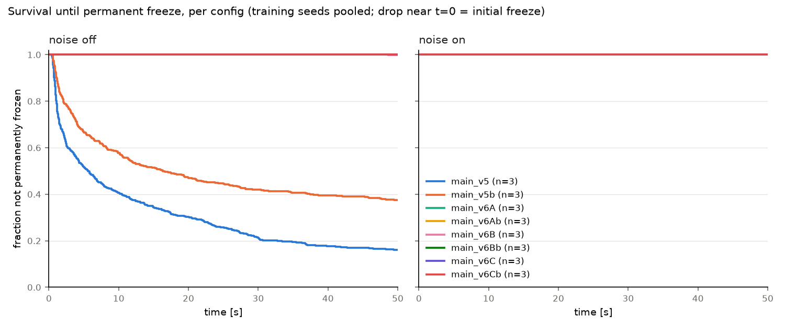

- **굳음은 노이즈 끔에서만 생겼습니다.** 노이즈 켬 960 에피소드에서는 영구 굳음이 0번입니다. 평균 행동만 쓰면 관절 8개가
  모두 한계에 붙은 자세에 들어가 빠져나오지 못하고(일시 굳음은 0~3%), 노이즈가 있으면 그 자세에 머물지 않습니다.
  평균 행동으로 돌린 폐루프 시스템에 이런 정지 상태(끌개)가 있다는 뜻으로 보이지만, 수학적으로 안정한 평형점인지는 확인하지 않았습니다.
- **노이즈 켬에서 굳지 않는다고 제대로 걷는 것은 아닙니다.** 네 발 모두 공중 42%, 관절 한계 근처 비율 0.76으로 튀는 이동이
  그대로입니다. v5b는 v5보다 엉덩이 관절이 한계에 더 오래 붙어 있습니다(0.75 → 0.83).
- **v5 → v5b 개선은 seed 3개 모두에서 보입니다.** 노이즈 끔 이동 성공률 0.65 → 0.74, 0.23 → 0.39, 0.03 → 0.42,
  노이즈 켬 속도 0.24 → 0.32, 0.12 → 0.22, 0.13 → 0.22 m/s.
- **seed 0은 실제로 좋은 seed입니다.** 15초까지만 보면 차이가 작아 보였지만(1e-9 실험의 평균 이동 확률 0.72 / 0.58 / 0.59),
  50초로 보면 seed 1, 2는 도중에 굳는 비율이 훨씬 높습니다. 추종 성공도 사실상 seed 0만 합니다.
- **15초 평가는 노이즈 끔 성능을 과대평가했습니다.** 예: v5b seed 0 속도 3~15초 0.31 → 3~50초 0.25 m/s.
- **남은 문제는 두 가지:** (A) 명령 속도 추종(노이즈 켬 0.25 m/s, 명령의 약 1/3), (B) 보행 방식(관절 한계에 붙은 채 튀는 이동,
  다리를 앞뒤로 휘둘러 바닥을 번갈아 미는 주기적 보행이 아님).

### v6 A/B/C: 관절 한계 페널티 (50초 반복 평가)

설계는 [아래](#v6-설계-관절-한계-페널티-범위강도-비교). v5에 보상 `− w × P_limit`(관절이 범위 끝 구간에 들어간 깊이)만 더하고,
500만 스텝 → 학습률 1e-4 고정 160만 스텝, 학습 seed 0, 1, 2. `run_v6.sh`로 데스크톱(16코어)에서 학습 18개 156분.
평가는 v5/v5b까지 24개 run을 **같은 데스크톱에서 다시** 돌렸습니다(3,840 에피소드 5.9분). 그래서 아래 v5b 값은 위 공식 표
(노트북)와 조금 다릅니다(예: 노이즈 끔 이동 성공률 0.52 → 0.50). 전체 표는 `runs/repeated/comparison.md`.

| 설정 | 범위 끝 구간 | 가중치 w |
| --- | --- | --- |
| A | 10% (`--limit-soft 0.9`) | 3.0 |
| B | 20% (`--limit-soft 0.8`) | 1.5 |
| C | 20% (`--limit-soft 0.8`) | 3.0 |

공정한 비교를 위해 이어 학습한 것끼리(v5b vs v6Ab/Bb/Cb) 봅니다. 학습 seed 3개 평균 ± 표준편차.

**노이즈 끔**

| 지표 | v5b | v6Ab | v6Bb | v6Cb |
| --- | --- | --- | --- | --- |
| 영구 굳음 | 0.62 ± 0.22 | **0** | **0** | **0** |
| 이동 성공률 (> 0.05 m/s) | 0.50 ± 0.17 | **0.96 ± 0.03** | 0.90 ± 0.13 | 0.83 ± 0.23 |
| 추종 성공률 (≥ 명령의 50%) | 0.09 ± 0.11 | 0.03 ± 0.03 | **0.10 ± 0.08** | 0.02 ± 0.03 |
| 명령 방향 속도 3~50초 (m/s) | 0.14 ± 0.08 | 0.17 ± 0.04 | **0.23 ± 0.08** | 0.14 ± 0.06 |
| 범위 끝 20% 비율 (엉덩이 / 발목) | 0.99 / 0.92 | 0.42 / 0.67 | 0.43 / 0.65 | 0.03 / 0.32 |
| 엉덩이 움직임 범위 p5–p95 | 6° | 33° | 28° | 25° |
| 네 발 모두 공중 | 0.14 | 0.42 | 0.45 | 0.58 |

**노이즈 켬 (README 성공 기준 ①~⑥)**

| 기준 | v5b | v6Ab | v6Bb | v6Cb | 판정 |
| --- | --- | --- | --- | --- | --- |
| ① 범위 끝 20% 비율 (엉덩이 / 발목) | 0.90 / 0.75 | 0.37 / 0.58 | 0.37 / 0.58 | 0.09 / 0.34 | ✅ 감소 |
| ② 엉덩이 움직임 범위 p5–p95 | 30° | 46° | 48° | 41° | ✅ 증가 |
| ③ 네 발 모두 공중 | 0.42 | 0.57 | 0.60 | 0.64 | ❌ 증가 |
| ④ 대각선 쌍 교대 (`pair_alternation`) | 0.01 | −0.00 | 0.02 | −0.00 | ➖ 변화 없음 (모두 ≈ 0) |
| ⑤ 속도 3~50초 / 추종 성공률 | 0.26 / 0.15 | 0.20 / 0.09 | 0.21 / 0.05 | 0.14 / 0.01 | ❌ 하락 |
| ⑥ 넘어짐 / 영구 굳음 | 0.02 / 0 | 0.03 / 0 | 0.07 / 0 | 0.11 / 0 | ❌ 넘어짐 증가 (특히 C) |

seed별 (v6Bb, seed 0 / 1 / 2): 노이즈 끔 이동 성공률 1.00 / 0.99 / 0.71, 속도 0.30 / 0.27 / 0.12 m/s.

- **확인된 것: 노이즈 끔의 굳음은 관절 한계 문제였습니다.** 관절을 범위 끝에서 떼어 놓자 18개 run 모두 영구 굳음이 0이 됐습니다.
  v6Bb는 노이즈 끔(0.23)과 켬(0.21) 속도가 거의 같아, v5b(0.14 vs 0.26)와 달리 **노이즈에 기대는 경향이 seed 3개 모두에서**
  사라졌습니다.
- **확인된 것: 관절은 더 크게 움직입니다**(①, ②). 그래서 성공 기준의 "한계 근처에서만 비켜선" 경우는 아닙니다.
- **안 된 것: 다리 교대 보행은 생기지 않았고(④), 튀는 이동은 더 심해졌습니다(③).** 노이즈 켬 속도·추종도 v5b보다 낮습니다.
- **설정 비교:** C는 관절을 가장 많이 떼어 놓지만 속도가 낮고 넘어짐이 가장 많아 페널티가 너무 강합니다. A는 가장 안정적이고
  (노이즈 끔 이동 0.96 ± 0.03), **B는 가장 빠르지만 seed 2가 약합니다.** 이후 실험의 기준은 v6Bb로 둡니다.

**영상으로 본 보행 (`python gait_analysis.py --case runs/main_v6Bb:12 --case runs/main_v5b:12 --case runs/main_v6Bb:10 --case runs/main_v6Bb:6 --out runs/gait_v6`)**

노이즈 끔, seed 0, 300스텝(evaluate.py와 같은 조건). 명령 번호 12 = 1.0 m/s 앞(0°), 10 = 1.0 m/s 270°, 6 = 0.5 m/s 90°.

| 사례 | 명령 방향 속도 | 주기 (강도) | 관절 범위 | 바닥에 닿은 발 수 평균 | 발별 접촉 비율 |
| --- | --- | --- | --- | --- | --- |
| v5b, 1.0 m/s 0° | 0.45 m/s | 0.35 s (0.75) | 25° | 0.73 | 0.06 / 0.21 / 0.20 / 0.26 |
| v6Bb, 1.0 m/s 0° | **0.54 m/s** | 0.35 s (0.29) | 32° | 0.65 | 0.18 / 0.05 / 0.30 / 0.12 |
| v6Bb, 1.0 m/s 270° | 0.28 m/s | 0.35 s (0.28) | 30° | 0.70 | 0.25 / 0.02 / 0.30 / 0.13 |
| v6Bb, 0.5 m/s 90° | 0.13 m/s | 0.25 s (0.52) | 34° | 0.70 | 0.26 / 0.11 / 0.30 / 0.02 |

 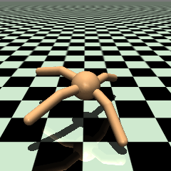

- **두 정책 모두 발을 짧게 톡톡 찍는 튀는 이동입니다.** 발 하나가 바닥에 닿아 있는 시간은 길어야 30%이고, 평균적으로 바닥에 닿은
  발은 1개도 안 됩니다. 몸통 높이가 0.6~0.73 m 사이를 약 0.35초 주기로 오르내립니다. 몸통·윗다리는 바닥에 끌리지 않습니다.
- **v5b(앞 명령)는 엉덩이 2개(다리 3, 4)와 발목 2개(다리 3, 4)가 한계에 거의 고정**돼 있고, 주로 발목 1과 엉덩이 2로 움직입니다.
- **v6Bb는 다리 2의 엉덩이(−30° ~ 0°)와 발목 2·4가 크게 움직여** 움직이는 관절이 늘었습니다. 다만 다리 1·4 엉덩이는 여전히
  +30° 근처, 다리 3 엉덩이는 −30° 근처, 발목 3은 −70°에 오래 머뭅니다. 페널티를 받으면서도 이 자세를 유지합니다.
- v6Bb는 주기성이 v5b보다 약합니다(0.29 vs 0.75). 더 많은 관절을 쓰지만 덜 규칙적입니다.
- 정리: v6는 **굳지 않고 더 많은 관절을 쓰게** 만들었지만, **바닥을 딛고 다리를 교대로 미는 보행**은 여전히 아닙니다.

### v7 A/B: 몸통 수직 속도 페널티 (50초 반복 평가)

설계와 사전 성공 기준은 [v7 설계](#v7-설계-몸통-수직-속도-페널티)에 있습니다. v6B 설정에 `− w_z × v_z²`만 더했고(A: w_z = 1.0, B: 3.0),
학습 seed 0, 1, 2 × (500만 스텝 + 이어 학습 160만 스텝) = 12 run을 학습했습니다. v5b, v6Bb도 같은 조건으로 다시 평가해
18 run을 비교했습니다(`runs/repeated_v7/comparison.md`). 아래는 이어 학습한 v7Ab, v7Bb와 기준 v6Bb의 학습 seed 3개 평균 ± 표준편차입니다.

| 지표 | 노이즈 | v5b | v6Bb | v7Ab | v7Bb |
| --- | --- | --- | --- | --- | --- |
| 명령 방향 속도 3~50초 (m/s) | 켬 | 0.26 ± 0.05 | **0.21 ± 0.06** | 0.17 ± 0.03 | 0.15 ± 0.02 |
| | 끔 | 0.14 ± 0.08 | **0.23 ± 0.08** | 0.15 ± 0.03 | 0.12 ± 0.02 |
| 이동 성공률 | 켬 | 0.96 | 0.87 | **0.94** | 0.92 |
| | 끔 | 0.50 | **0.90** | 0.85 | 0.73 |
| 넘어짐 | 켬 | 0.02 | 0.07 | 0.01 | **0.00** |
| 몸통 수직 속도² v_z² | 켬 | 0.20 | 0.21 | 0.14 | **0.09** |
| 네 발 동시 공중 | 켬 | **0.42** | 0.60 | 0.54 | 0.47 |
| 엉덩이 범위 p5–p95 | 켬 | 30° | 48° | 48° | 49° |
| 발목 범위 p5–p95 | 켬 | 21° | **30°** | 21° | 15° |
| 발목이 범위 끝 20%에 있는 비율 | 켬 | 0.75 | **0.58** | 0.68 | 0.78 |
| 몸통 바닥 접촉 | 켬 | 0.02 | 0.07 | 0.02 | **0.006** |
| 대각선 쌍 교대 | 켬 | 0.01 | 0.02 | 0.02 | 0.02 |

**사전 성공 기준 판정** (노이즈 켬, seed 3개 평균, v6Bb 대비)

| 기준 | v7Ab | v7Bb |
| --- | --- | --- |
| v_z² 20% 이상 감소 | ✅ 0.214 → 0.144 (−33%) | ✅ 0.214 → 0.089 (−58%) |
| 네 발 공중 0.50 이하 | ❌ 0.54 | ✅ 0.47 |
| 엉덩이 범위 v6Bb의 80% 이상 | ✅ 102% | ✅ 104% |
| 몸통 높이 0.5 m 이상 | ✅ 0.63 m | ✅ 0.64 m |
| 몸통 접촉 1% 미만 / 윗다리 접촉 1% 미만 | ❌ 2.3% / ✅ 0.4% | ✅ 0.6% / ✅ 0.1% |
| 속도가 v6Bb − 표준편차(0.212 − 0.058 = 0.154) 이상 | ✅ 0.167 | ❌ 0.147 |
| 대각선 쌍 교대 뚜렷하게 증가 | ❌ 0.02 | ❌ 0.02 |

모든 기준을 통과한 설정은 없습니다. 미리 정한 해석표의 어느 줄에도 딱 맞지 않습니다. v_z²와 공중 비율이 함께 줄었고(B),
웅크리지도 않았지만, 속도가 떨어지고 교대 보행은 나오지 않았습니다.

**영상으로 본 보행 (`python gait_analysis.py --case runs/main_v7Bb:12 --case runs/main_v7Bb:10 --case runs/main_v7Bb:6 --case runs/main_v7Ab:12 --case runs/main_v6Bb:12 --out runs/gait_v7`)**

노이즈 끔, seed 0, 300스텝. 영상과 그래프를 한 화면에서 보려면 `runs/gait_v7/index.html`을 브라우저로 여세요.

| 사례 | 명령 방향 속도 | 주기 (강도) | 관절 범위 | 바닥에 닿은 발 수 평균 | 발별 접촉 비율 |
| --- | --- | --- | --- | --- | --- |
| v6Bb, 1.0 m/s 0° | **0.54 m/s** | 0.35 s (0.29) | 32° | 0.65 | 0.18 / 0.05 / 0.30 / 0.12 |
| v7Ab, 1.0 m/s 0° | 0.16 m/s | 1.35 s (0.10) | 29° | 0.65 | 0.13 / 0.14 / 0.20 / 0.18 |
| v7Bb, 1.0 m/s 0° | 0.04 m/s | 1.70 s (0.16) | 23° | 0.91 | 0.19 / 0.34 / 0.13 / 0.25 |
| v7Bb, 1.0 m/s 270° | 0.15 m/s | 4.20 s (0.12) | 23° | 0.84 | 0.03 / 0.38 / 0.12 / 0.31 |
| v7Bb, 0.5 m/s 90° | 0.06 m/s | 5.20 s (0.02) | 21° | 0.92 | 0.27 / 0.28 / 0.22 / 0.15 |

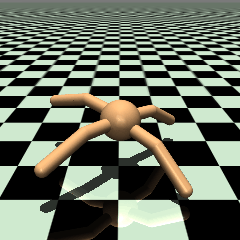 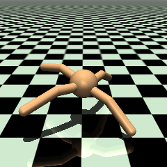 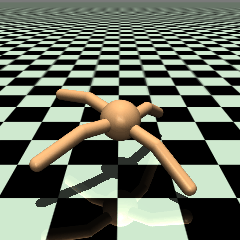

- **v7은 발목 4개를 모두 관절 한계(±70°)에 붙여 둔 채 엉덩이만으로 움직입니다.** v7Bb 앞 명령에서는 발목 각도가 15초 내내 거의
  변하지 않고, v7Ab도 발목 하나가 잠깐 움직이는 정도입니다. v6Bb는 발목 2·4가 −70°~−30°, 30°~70° 사이를 크게 오갑니다.
- 발목을 펴지 않으니 몸을 밀어 올리지도 않습니다. 몸통 높이는 0.63~0.64 m로 거의 평평하고(v6Bb는 0.60~0.73 m 출렁임),
  다리는 바닥을 짧게 자주 찍습니다(v7Bb 착지 초당 약 15회). 노이즈 끔에서는 거의 제자리 종종걸음입니다.
- 즉 v_z 페널티는 **"튀지 말고 걸어라"가 아니라 "발목을 쓰지 마라"로 풀렸습니다.** 이 Ant 모델에서는 발목이 수평 추진의 주된 수단이라
  발목을 잠그면 속도도 함께 줄어듭니다. 반복 평가의 발목 범위 감소(30° → 15°)와 범위 끝 비율 증가(0.58 → 0.78)가 같은 현상입니다.
- 걸음 모양 지표는 좋아졌지만(출렁임·공중 비율·몸통 접촉·넘어짐 감소) 교대 보행이 아니고 속도를 잃었으므로 **기준은 v6Bb로 유지합니다.**

### v8: 행동 공간 × 추종 커널 2×2 + 탐색 노이즈 (50초 반복 평가)

설계, 합격선, 해석표는 학습 전에 [`docs/V8_DESIGN.md`](docs/V8_DESIGN.md)에 고정했습니다. 다섯 갈래 모두 v6B 보상 설정을 쓰고, 학습 seed 0, 1, 2 × (500만 + 이어 학습 160만 스텝)로 돌렸습니다.

| 갈래 | 행동 | 추종 커널 | 바꾼 것 |
| --- | --- | --- | --- |
| A = v6Bb | 토크 | K0 = 5·exp(−e²/1) | 기준 |
| B | 관절 목표 각도 + PD (kp 120, kd 21) | K0 | 행동 공간 |
| D | PD | K1 = 2.5·exp(−e²/1) + 2.5·exp(−e²/0.25) | 행동 공간 + 보상 모양 |
| E | 토크 | K1 | 보상 모양 |
| C | 토크 | K0 | 초기 탐색 σ 1 → 0.1 |

PD 이득은 학습 전에 정했습니다. 사전 시험에서 손으로 짠 트롯 1152개는 모두 실패했지만, CMA-ES가 kp 120에서 합격 패턴(0.35 m/s, 디딤 0.11 s, 미끄러짐 0.47)을 찾았습니다(`pd_pretest.py`, `cma_gait.py`, 설계 8절).

**판정 (노이즈 끔, seed 3개 평균, 괄호는 노이즈 켬, `runs/repeated_v8/judgement.md`)**

| 항목 | 합격선 | A (v6Bb) | B (PD, K0) | D (PD, K1) | E (토크, K1) | C (σ 0.1) |
| --- | --- | --- | --- | --- | --- | --- |
| 추종 성공률 | ≥ 0.5 | 0.10 ❌ | 0.19 ❌ | 0.00 ❌ | 0.00 ❌ | 0.32 ❌ |
| 명령 방향 속도 (m/s) | ≥ 0.40 | 0.23 ± 0.08 ❌ | 0.23 ± 0.11 ❌ | 0.11 ± 0.06 ❌ | 0.11 ± 0.03 ❌ | 0.29 ± 0.09 ❌ |
| 이동 성공률 | ≥ 0.95 | 0.90 ❌ | 0.88 ❌ | 0.75 ❌ | 0.72 ❌ | **0.96 ✅** |
| 영구 굳음 | 0 | 0 ✅ | 0 ✅ | 0 ✅ | 0 ✅ | 0 ✅ |
| 디딤 지속 (s) | ≥ 0.10 | 0.026 ❌ | 0.028 ❌ | 0.028 ❌ | 0.027 ❌ | 0.028 ❌ |
| 하중 시간 비율 | ≥ 0.30 | 0.18 ❌ | 0.23 ❌ | 0.27 ❌ | 0.21 ❌ | 0.22 ❌ |
| 네 발 공중 | ≤ 0.20 | 0.45 ❌ | 0.28 ❌ | 0.22 ❌ | 0.40 ❌ | 0.32 ❌ |
| 하중 디딤 중 미끄러짐 | ≤ 0.50 | 0.89 ❌ | 0.85 ❌ | 0.83 ❌ | 0.85 ❌ | 0.84 ❌ |
| 관절 한계 점유 | ≤ 0.20 | 0.44 ❌ | **0.02 ✅** | **0.02 ✅** | 0.46 ❌ | **0.12 ✅** |
| 넘어짐 | ≤ 0.02 (켬 ≤ 0.05) | 0 ✅ (0.07 ❌) | 0 ✅ (0) | 0 ✅ (0) | 0 ✅ (0.04) | 0 ✅ (0.002) |

**"걷는다" 판정을 받은 갈래는 없습니다.** 합격선은 그대로 둡니다(설계 원칙). 학습 전 정책과 비교하면(노이즈 켬), 학습 전 E는 94%가 넘어지고 B·D·C는 하나도 넘어지지 않았습니다. 학습 후 명령 방향 속도는 B 0.19, D 0.10, E 0.15, C 0.28 m/s입니다.

측정된 것:

- **관절 한계에 붙어 버티는 문제는 행동 공간(B, D)이나 작은 탐색 노이즈(C)로 사라졌습니다.** 한계 점유가 0.44에서 0.02~0.12로 줄고, 노이즈 켬 넘어짐도 0에 가까워졌습니다.
- **디딤은 어느 갈래에서도 생기지 않았습니다.** 하중 디딤 지속은 다섯 갈래 모두 0.026~0.028 s이고, 디딤의 80% 넘게 미끄러집니다. 사전 시험의 손 패턴(0.11 s)과 같은 계산 함수로 잰 값이라 측정 문제는 아닙니다.
- **두 항 커널(K1)은 PD와 토크 모두에서 나빠졌습니다.** 속도가 절반이고 추종 성공률이 0에 가깝습니다.
- **seed 간 편차가 큽니다.** 속도 표준편차가 0.03~0.11 m/s여서 C(0.29)와 A·B(0.23)의 차이는 표준편차 하나 안입니다.
- **같은 움직임을 PD는 훨씬 적은 힘으로 냅니다.** 앞 1.0 m/s 명령에서 노력 Σ(τ/150)²는 A 3.7~4.0, B 0.24~0.27이고, 일률은 A 약 1200 W, B 약 180 W입니다(`evaluate.py`, `results/energy.png`). 에너지 다이얼 e에는 다섯 갈래 모두 반응하지 않습니다.

**설계 11절 해석표:** "B와 D가 움직이지만 3·4번(디딤 지속, 하중 시간 비율)을 못 넘는다 → 디딤이 생기지 않았다. 행동 공간 가설이 약해진다"에 해당합니다. 행동 공간은 관절 한계 문제를 풀었지만 디딤을 만들지는 못했습니다. 남은 후보는 디딤을 유도하는 항이 없는 보상, 관측, 학습량입니다(아직 검증하지 않은 가설). 표에 없는 결과도 하나 있습니다. D는 느린 명령에서도 걷지 않았습니다(0.5 m/s 추종 0.00).

**영상으로 본 보행 (`python gait_analysis.py --case runs/main_v8Bb:12 --case runs/main_v8Bb:6 ... --out runs/gait_v8`)**

노이즈 끔, seed 0, 300스텝(15초)입니다. 한 번씩만 굴린 결과라 위의 50초 평균과 다릅니다.

| 사례 | 명령 방향 속도 | 주기 (강도) | 관절 범위 | 바닥에 닿은 발 수 평균 | 몸통 높이 평균 |
| --- | --- | --- | --- | --- | --- |
| A (v6Bb), 1.0 m/s 0° | 0.54 m/s | 0.35 s (0.29) | 32° | 0.65 | 0.64 m |
| **B, 1.0 m/s 0°** | **0.98 m/s** | 0.50 s (**0.78**) | 32° | 0.62 | 0.56 m |
| D, 1.0 m/s 0° | 0.14 m/s | 0.60 s (0.10) | 18° | 1.35 | 0.56 m |
| E, 1.0 m/s 0° | 0.11 m/s | 1.80 s (0.14) | 24° | 1.03 | 0.48 m |
| C, 1.0 m/s 0° | 0.10 m/s | 1.20 s (0.22) | 28° | 1.07 | 0.58 m |
| A (v6Bb), 0.5 m/s 90° | 0.13 m/s | 0.25 s (0.52) | 34° | 0.70 | 0.63 m |
| B, 0.5 m/s 90° | 0.12 m/s | 0.50 s (0.42) | 22° | 1.22 | 0.55 m |
| D, 0.5 m/s 90° | 0.20 m/s | 0.25 s (0.47) | 16° | 1.32 | 0.56 m |
| E, 0.5 m/s 90° | 0.21 m/s | 0.55 s (0.08) | 13° | 1.25 | 0.49 m |
| C, 0.5 m/s 90° | 0.10 m/s | 4.05 s (0.12) | 23° | 1.15 | 0.57 m |

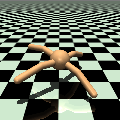  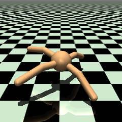

- **B seed 0은 앞 명령에서 0.5초 주기의 아주 규칙적인 리듬으로 0.98 m/s를 냅니다.** 지금까지 본 것 중 가장 빠르고 규칙적입니다(주기 강도 0.78). 그러나 발은 짧게만 닿고(초당 착지 9.9회) 몸통이 0.47~0.65 m로 크게 출렁여서, 디딤 보행이 아니라 통통 튀며 나아가는 움직임입니다. 옆 명령(0.5 m/s 90°)에서는 0.12 m/s밖에 못 갑니다.
- 50초 반복 평가에서 B seed 0의 속도는 0.38 m/s이고, seed 1·2는 0.14~0.16 m/s입니다. 위 앞 명령 결과는 가장 잘 되는 경우입니다.

### v9: 디딤 보상 (50초 반복 평가)

v8 B에 디딤 보상 하나만 더했습니다([`docs/V9_DESIGN.md`](docs/V9_DESIGN.md)). 체중이 실린 발이 0.05초보다 오래 디디는 동안 몸이 명령 방향으로 나아가면, 발을 뗄 때 보너스를 줍니다. 가중치 40은 학습 전 사전 시험 규칙으로 정했습니다. 합격선은 v8과 같습니다. 결과는 `runs/repeated_v9/judgement.md`에 있습니다.

| 항목 (노이즈 끔, seed 3개 평균) | 합격선 | B (v8) | F (B + 디딤 보상) | H (F + σ 0.1) |
| --- | --- | --- | --- | --- |
| 추종 성공률 | ≥ 0.5 | 0.19 | 0.37 | 0.00 |
| 속도 [m/s] | ≥ 0.40 | 0.23 | 0.28 | 0.01 |
| 이동 성공률 | ≥ 0.95 | 0.88 | 0.88 | 0.03 |
| 디딤 지속 [s] | ≥ 0.10 | 0.028 | 0.028 | 0.070 |
| 하중 시간 비율 | ≥ 0.30 | 0.23 | 0.23 | 0.49 |
| 네 발 공중 | ≤ 0.20 | 0.28 | 0.30 | 0.005 |
| 넘어짐 | ≤ 0.02 | 0 | 0 | 0 |

**"걷는다" 판정을 받은 갈래는 없습니다.**

- **F: 디딤은 B와 같고(0.028 s), 추종과 속도만 조금 나아졌습니다.** 학습 중 디딤 보너스(텐서보드 `command/stance_bonus`)는 스텝당 0.0004~0.0014로, CMA 디딤 패턴이 받는 값(0.016~0.032)의 약 1/20입니다. 정책이 긴 디딤을 거의 해 보지 않아 보상 기울기가 생기지 않았습니다. 설계 6절 해석표의 "탐색 문제"에 해당합니다.
- **F는 seed 차이가 큽니다.** seed 0은 추종 0.65, 속도 0.45 m/s로 이 두 항목은 넘지만, 여전히 디딤 없이 튀며 나아갑니다(네 발 공중 0.36). seed 2는 추종 0, 속도 0.09입니다. 평균만으로 F가 B보다 낫다고 확정하지 않습니다.
- **H는 서 있기에 빠졌습니다.** 하중·공중·미끄러짐 항목을 통과하지만, 거의 움직이지 않아서(0.01 m/s) 생기는 숫자입니다. σ 0.1의 PD 정책은 처음부터 서 있는 자세(학습 전 평균 토크 3.5 N·m)로 시작합니다. 사전 시험에서 서 있기 점수가 B와 거의 같았으므로(0.5 m/s에서 4.89 대 4.94), 거기서 벗어날 기울기가 약했던 것으로 봅니다(가설). 디딤 보너스는 서 있기에 0을 주므로, 보상이 서 있기를 직접 유도한 것은 아닙니다.

### 추진·접촉 분석 (Propulsion and Contact Analysis): v5b · v6Bb · v7Ab · v7Bb

v7이 어떻게 속도를 잃었는지 보려다, v6Bb 이전부터 있던 문제를 확인한 분석입니다. 보상은 바꾸지 않고 측정만 했습니다.

- **방법:** `python propulsion_analysis.py` (결과 `runs/propulsion_v7/summary.json`, `stance_profile.png`). 각 설정의 학습 seed 3개 ×
  명령 16개 × 노이즈 끔/켬, evaluate.py와 같은 조건(300 제어 스텝, 워밍업 60). 제어 스텝(0.05초) 안의 **물리 스텝(0.01초)마다**
  발-바닥 접촉, 접촉점 속도, 지면 반력을 기록했습니다.
- **지면 반력:** 접촉마다 `mj_contactForce` → 월드 좌표계로 변환 → 로봇이 받는 힘으로 부호 통일 → 수평 성분은 **월드 좌표계에서
  명령 방향**으로 투영(몸이 돌아도 명령 방향으로 미는지를 봄). MuJoCo 접촉은 각각 별개의 접촉점이라 합산해도 중복이 없습니다.
- **검증:** 로봇 전체 수직 반력의 시간 평균 = 0.97~1.02 mg(전 run), 명령 방향 수평 반력 평균 ≈ 0(±0.07 N). 측정용으로 물리 스텝을
  하나씩 돌려도 궤적은 원래와 완전히 같습니다(qpos 차이 0).
- **디딤:** 한 발이 연속으로 닿은 물리 스텝 구간. "명령 방향 힘이 +"는 바닥이 로봇을 명령 방향으로 미는 것(추진), "−"는 제동.

**결과 (학습 seed 3개 평균, 노이즈 끔 / 켬)**

| 지표 | v5b | v6Bb | v7Ab | v7Bb |
| --- | --- | --- | --- | --- |
| 디딤 지속 시간 중간값 (초) | 0.04 / 0.03 | 0.03 / 0.03 | 0.03 / 0.03 | 0.03 / 0.02 |
| 0.02초 이하 디딤 비율 | 0.30 / 0.40 | 0.44 / 0.45 | 0.48 / 0.49 | 0.49 / 0.52 |
| 0.05초 미만 디딤 비율 | 0.60 / 0.74 | 0.83 / 0.83 | 0.87 / 0.86 | 0.87 / 0.88 |
| 0.10초 이상 디딤 비율 | 0.14 / 0.05 | 0.005 / 0.002 | 0.006 / 0.002 | 0.010 / 0.005 |
| 초당 디딤 수 (발 4개 합) | 14 / 23 | 26 / 19 | 31 / 23 | 35 / 27 |
| 디딤 중간 접촉점 미끄러짐 (m/s) | 0.29 / 0.35 | 0.38 / 0.54 | 0.31 / 0.46 | 0.25 / 0.37 |
| 디딤 중간에 0.1 m/s 이상 미끄러지는 비율 | 0.49 / 0.68 | 0.82 / 0.92 | 0.82 / 0.91 | 0.77 / 0.86 |
| 마찰 사용률 \|F_수평\| / F_수직 중간값 (마찰 계수 1.0) | 0.75 / 0.83 | 0.86 / 0.87 | 0.86 / 0.87 | 0.86 / 0.87 |
| 디딤 패턴 "제동 → 추진" (정상 보행 형태, 0.03초 이상 디딤) | 0.13 / 0.16 | 0.19 / 0.17 | 0.20 / 0.17 | 0.20 / 0.18 |
| 디딤 패턴 "추진 → 제동" | 0.19 / 0.19 | 0.20 / 0.19 | 0.20 / 0.19 | 0.19 / 0.18 |
| 착지 순간 / 이륙 직전 명령 방향 힘 (N, 평균 곡선) | 2.07 / −2.34 | 1.07 / −0.44 | 0.51 / −0.35 | 0.08 / −0.03 |
| 착지 순간 수직 힘 (N, 평균 곡선, 무게 8.9 N) | 15.7 | 17.9 | 14.8 | 12.6 |
| 엉덩이 / 발목 각속도 RMS (rad/s, 노이즈 끔) | 0.45 / 1.36 | 2.70 / 2.45 | 2.71 / 1.76 | 2.72 / 1.44 |

(착지·이륙 힘과 수직 힘은 노이즈 끔 값. 노이즈 켬도 경향이 같습니다. 그림: `runs/propulsion_v7/stance_profile.png`)

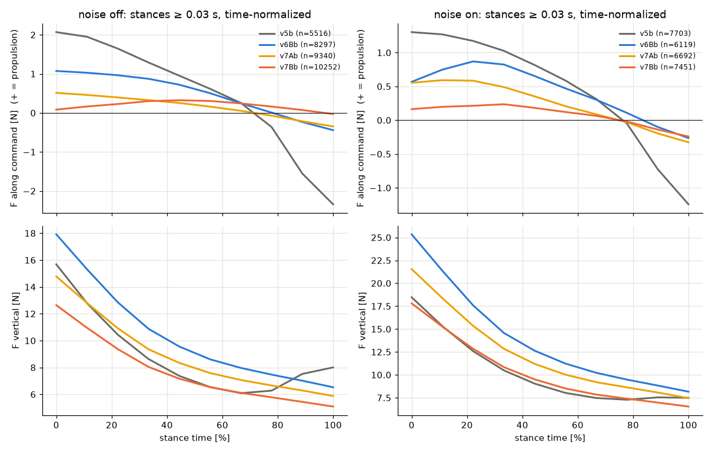

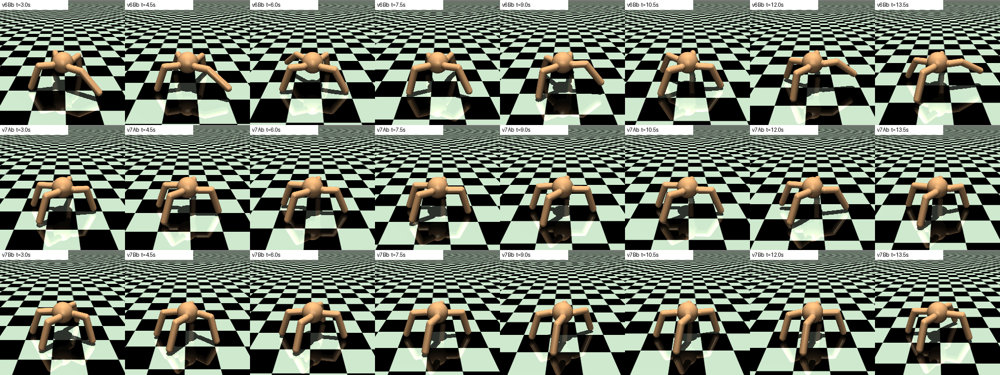

**확인된 것 (측정 결과)**
- **접촉은 실제로 매우 짧습니다.** 제어 스텝 단위(0.05초)로 잴 때보다 더 짧아, 디딤의 중간값이 0.02~0.03초(물리 스텝 2~3개)이고
  0.1초 이상 이어지는 디딤은 v6Bb·v7에서 1% 이하입니다.
- **수직 반력은 착지 순간에 가장 크고(평균 곡선 기준 체중의 노이즈 끔 1.4~2.0배, 켬 2.0~2.8배) 이후 계속 줄어듭니다.** 체중을 싣고 버티는 지지 단계가 아니라 충돌에 가까운 모양입니다.
- **수평 반력의 평균 모양이 정상 보행과 반대입니다.** 착지 순간에 명령 방향으로 밀리고(+) 이륙 직전에 제동(−)이 걸립니다.
  정상 보행 형태인 "제동 → 추진" 디딤은 13~20%뿐이고, 네 가지 패턴이 고르게 섞여 있습니다.
- **발은 닿아 있는 동안에도 대부분 미끄러집니다.** 디딤 중간에도 77~92%가 0.1 m/s 이상 미끄러지고, 마찰 사용률이 0.86으로 마찰 한계(1.0)에
  가깝습니다. 발이 바닥에 고정된 채 몸을 밀어내는 것이 아니라, 미끄러지는 마찰로 몸을 끌고 갑니다.
- **v7의 변화:** 착지 충격(수직 힘 17.9 → 12.6 N)과 착지 순간 명령 방향 힘(1.07 → 0.08 N)이 함께 줄었고, 대신 디딤 수가 늘었습니다(26 → 35회/초).
  엉덩이 움직임은 같고 발목 움직임만 줄었습니다. 수직 속도 페널티가 착지 충격을 줄였고, 지금의 추진은 그 충격에 실려 있었기 때문에
  속도도 함께 줄었다는 해석과 맞습니다(인과는 확인하지 않음).
- v5b(노이즈 끔)의 긴 디딤(0.1초 이상 14%, 바닥에 닿은 발 평균 2.1개)은 대부분 굳어서 서 있는 시간입니다. 걷는 동안의 디딤은 v5b도 짧습니다(노이즈 켬).

**해석 (가설)**

> v5b, v6Bb, v7Ab, v7Bb 모두 짧은 충돌형 접촉과 발 미끄러짐에 의존하는 이동 방식을 보였다. v7의 수직 속도 페널티는 발목 움직임과
> 착지 충격을 줄였지만, 엉덩이 움직임을 늘리거나 디딤(stance) 단계를 만들지 못했다. 따라서 지금 이동 방식의 근본 문제는 관절 한계나
> 수직 운동 자체보다, **발을 일정 시간 지면에 고정하고 그 동안 지면을 밀어내는 디딤 단계가 형성되지 않는 것**일 가능성이 있다.
> 속도 추종 부족과 교대 보행 부재도 같은 원인에서 나올 수 있다.

**측정의 한계**
- Ant-v5는 RK4 적분기라, `mj_step` 뒤 data에 남은 접촉력은 마지막 RK 단계 값입니다(이 값을 쓰면 수직 반력 평균 1.07 mg, 충격량-운동량 불일치).
  그래서 매 물리 스텝 **시작 상태**에서 `mj_forward`로 다시 계산한 접촉력을 썼습니다. RK4 네 단계의 가중 평균이 아니라 첫 단계 값이므로 근사이고,
  12초 동안의 충격량-운동량 오차는 수평 총 충격량의 약 2%입니다.
- 접촉 시간 해상도는 0.01초입니다. 0.01초로 잡힌 디딤은 그보다 짧을 수 있습니다.
- 디딤 패턴과 평균 곡선은 0.03초 이상 디딤만 사용했습니다(0.02초 이하 디딤은 앞/뒤 절반을 나눌 수 없음).
- 지난 버전(제어 스텝 단위)의 "디딤의 82%가 한 스텝" 값은 이 분석으로 대체합니다. "미는 디딤 비율 ≈ 0.5"는 정상 보행도 제동과 추진이
  섞이므로 추진이 없다는 근거로 쓰지 않습니다. 정상 상태에서는 공기 저항이 없어 수평 반력 평균이 0이 되는 것도 당연합니다.
- 평가 조건(명령 16개, 평가 seed 0, 에너지 0.5) 한 가지에서만 쟀습니다.

### 기준선 보상 비교: 학습된 정책 vs 아무것도 안 하기 / 서 있기

v6 → v7에서 증상마다 페널티를 하나씩 붙이기 전에 확인했어야 할 질문입니다. **학습된 정책은 자기 보상 함수 기준으로
"아무것도 안 하기"보다 나은가?** 보상은 바꾸지 않고 측정만 했습니다.

- **방법:** `python baseline_rewards.py` (결과 `runs/baselines/summary.json`, 노트북 5초). v6B 보상, 학습 때와 같은 랜덤 명령
  (250스텝마다 재샘플), 1000스텝 × 8 에피소드의 에피소드 보상 합. 학습 로그의 `ep_rew_mean`과 같은 단위입니다.
- **PD 서기:** 관절마다 `τ = 50 (q_가운데 − q) − 10 q̇`로 관절을 범위 가운데(엉덩이 0°, 발목 ±50°)에 두는, 손으로 짠 제어기입니다. 학습 없음.
- **무작위 정책:** 학습 시작 때 정책처럼 `a = tanh(σ z)`, σ = 1.0. "목표 각도"는 같은 a를 관절 목표 각도(가운데 + a × 반범위)로
  해석하고 위 PD로 토크를 만든 것입니다.

| 정책 | 에피소드 보상 (평균 ± 표준편차) | 버틴 스텝 (최대 1000) | 평균 \|토크\| (N·m) |
| --- | --- | --- | --- |
| 학습된 v6Bb, 노이즈 켬 (PPO가 실제로 최적화하는 값, 학습 로그 2930과 일치) | 2933 ± 576 | 959 | 101 |
| 토크 0, 아무것도 안 함 | 3353 ± 684 | 1000 | 0 |
| 학습된 v6Bb, 노이즈 끔 | 3542 ± 584 | 1000 | 98 |
| 손으로 짠 PD로 관절을 범위 가운데에 두고 서 있기 | **3842 ± 683** | 1000 | 0.5 |
| 학습 안 된 무작위 정책, 행동 = 토크 (σ 1.0) | 352 ± 737 | 164 | 84 |
| 학습 안 된 무작위 정책, 행동 = 관절 목표 각도 (σ 1.0) | 3715 ± 628 | 1000 | 14 |

**확인된 것 (측정 결과)**
- **학습된 v6Bb(노이즈 켬)는 토크 0과 PD 서기보다 보상이 낮습니다.** PPO가 최적화하는 값(노이즈 켬)이 660만 스텝 뒤에도
  "가만히 서 있기"에 못 미칩니다. 명령을 잘 따라가면 이론상 5000점 이상이 가능하므로, 보상이 더 좋은 답을 허락하지 않는 상황은 아닙니다.
- **v6Bb는 서 있는 데 필요한 토크의 약 200배(평균 약 100 N·m vs 0.5 N·m)를 씁니다.** Ant는 0.91 kg이고 행동 1.0이 150 N·m입니다.
- **같은 크기의 노이즈라도 어디에 넣느냐에 따라 결과가 전혀 다릅니다.** 토크에 넣으면 평균 164스텝 만에 넘어지고(보상 352),
  관절 목표 각도에 넣으면 학습 전부터 1000스텝을 서 있습니다(보상 3715, PD 서기와 비슷).

**해석 (가설)**

> 행동이 150 N·m 단위의 토크라, 학습 초기 탐색 노이즈(σ 1.0, 이어 학습 끝에도 약 0.65)는 평균 수십 N·m의 무작위 토크가 된다.
> 정책은 먼저 "자기 노이즈에 넘어지지 않는 법"을 배웠고, 관절을 한계에 밀어 붙여 버티는 자세가 그 답이었을 수 있다.
> 영구 굳음(v5b), 짧은 충돌형 접촉, 반응 없는 에너지 다이얼, v7의 발목 잠그기가 모두 이 한 가지로 설명될 수 있다.
> 그렇다면 페널티를 더 붙이기보다 **행동 공간을 관절 목표 각도로 바꾸는 것**이 먼저다. 학습으로는 아직 확인하지 않았다.

**측정의 한계**
- 학습된 정책은 v6Bb seed 0 하나, 에피소드 8개입니다. 에피소드 간 표준편차(약 600)가 커서 토크 0과 v6Bb 노이즈 끔의 차이(약 190)는
  확실하지 않습니다. 노이즈 켬 v6Bb(2933)가 PD 서기(3842)보다 낮다는 것만 결론으로 씁니다.
- PD 이득(kp 50, kd 10)은 손으로 고른 값 하나입니다.

**공식 평가 조건으로 다시 잰 값 (2026-11-11, `python baseline_rewards.py --official`, 결과 `runs/baselines/official_v6B.json`)**

명령 16개 × 초기 상태 10개 × 1000스텝, 에너지 0.5, v6B 보상. 같은 (명령, 초기 상태)끼리 비교합니다.

| 정책 | 에피소드 보상 | 0.5 m/s 명령 | 1.0 m/s 명령 | PD 서기보다 낮은 쌍의 비율 |
| --- | --- | --- | --- | --- |
| PD 서기 | **3864** | 4890 | 2838 | – |
| 토크 0 | 3409 | 4433 | 2386 | 1.00 |
| v6Bb 노이즈 끔 (학습 seed 3개) | 3432 ± 274 | 4051 | 2812 | 0.58 / 0.70 / 0.99 |
| v6Bb 노이즈 켬 (학습 seed 3개) | 3003 ± 153 | 3610 | 2397 | 0.90 / 0.91 / 1.00 |

- 노이즈 켬이 PD 서기보다 낮다는 결론은 그대로입니다. 노이즈 끔은 토크 0과 비슷한 수준입니다.
- **새로 보인 것:** 0.5 m/s 명령에서는 서 있기만 해도 최대(약 6000)의 80%를 받습니다. 느린 명령에서는 걸을 이유가 약하므로 보상 모양도 용의자입니다.
  v8의 두 항 커널로 같은 측정을 하면 PD 서기가 2914점(0.5 m/s 명령 3863, 1.0 m/s 1964)으로 내려갑니다(`official_v6B_two_term.json`).

#### 참고 기록: 15초 단일 평가

아래 "학습 과정 비교"와 "평가" 표, 그리고 "seed 반복" 표는 명령당 한 번만 굴린 결과입니다. v2~v5b는 모두 seed 0입니다.

### 학습 과정 비교 (텐서보드, 각 500만 스텝)

|                                       | v1                    | v2                    | v3                    | v4                    | v4b                   | v5                    | v5b                   |
| ------------------------------------- | --------------------- | --------------------- | --------------------- | --------------------- | --------------------- | --------------------- | --------------------- |
| 학습 스텝                             | 500만                 | 500만                 | 500만                 | 500만                 | 674만 (평가는 660만)  | 500만                 | 661만                 |
| 학습 시간                             | 82분                  | 59분                  | 68분                  | 69분                  | +약 25분              | 약 60분 (중간에 끊겨 이어 학습) | +4분 (16코어)  |
| 버틴 길이 `ep_len_mean` (최대 1000) | 371                   | 885                   | 979                   | 982                   | 991                   | 998                   | 993                   |
| 속도 오차 `tracking_error_mps`      | 0.95                  | 0.84                  | 0.75 ~ 0.85           | 0.58 (최저 0.55)      | 0.60 (최저 0.53)      | 0.63 (최저 0.57)      | 0.67 (최저 0.55)      |
| `approx_kl` (정상 약 0.01–0.03)    | **4.11 (폭발)**       | 0.000001              | 0.0000001             | 0.0000002             | 0.012                 | 0.0000005             | 0.011                 |
| 행동 표준편차 `std`                 | 0.144 (붕괴)          | 0.703                 | 0.670                 | 0.700                 | 0.663                 | 0.701 (tanh 전)       | 0.656 (tanh 전)       |

학습 중 명령은 10% 확률로 정지, 나머지는 0.2~1.5 m/s에서 뽑으므로, 학습 중 서 있기만 할 때의 오차는 약 0.77입니다.
v4는 처음으로 이 기준보다 확실히 낮아졌고, 학습이 끝날 때까지 계속 내려가고 있었습니다(4백만 스텝 0.76 → 5백만 스텝 0.58).
학습 중 지표는 탐색 노이즈가 켜진 행동으로 잰 값입니다. v4b는 학습률을 고정해서 끝까지 `approx_kl`이 정상 범위(0.012)로,
실제로 계속 배우고 있었습니다(학습률이 0으로 줄어든 v2~v5는 끝 무렵 거의 0).
v1·v2 수치는 이전 학습 기록에서 옮겼고, 학습 컴퓨터가 달라 학습 시간은 직접 비교하기 어렵습니다.

### 평가 (참고 기록: `python evaluate.py --run runs/<폴더>`, 명령당 한 번, 15초)

속도 2개(0.5, 1.0 m/s) × 8방향 = 16개 명령을 주고, 명령마다 300스텝씩 굴려 평가했습니다.
- **노이즈 끔(deterministic):** 정책의 평균 행동만 사용. 실제로 쓸 때의 실력
- **노이즈 켬(stochastic):** 학습 때처럼 탐색 노이즈를 섞어 행동을 뽑음
- **행동 진단:** 명령 1 m/s 앞, 노이즈 끔. 포화 비율 = 관절 행동이 한계(±1)에 붙은 비율(|a| > 0.99)

| 지표 | v2 | v3 | v4 | v4b | v5 | v5b |
| --- | --- | --- | --- | --- | --- | --- |
| 평균 오차, 노이즈 끔 (서 있기 기준 0.75) | 0.750 | 0.749 | 0.739 | 0.643 | 0.597 | **0.514** |
| 평균 오차, 노이즈 켬 | 0.702 | 0.646 | 0.568 | **0.409** | 0.525 | 0.511 |
| 명령 방향 속도, 노이즈 끔 | 0.000 m/s | 0.001 m/s | 0.011 m/s | 0.117 m/s | 0.251 m/s | **0.317 m/s** |
| 명령 방향 속도, 노이즈 켬 | 0.050 m/s | 0.107 m/s | 0.197 m/s | **0.365 m/s** | 0.251 m/s | 0.274 m/s |
| **끔/켬 차이 G = \|v_켬 − v_끔\|** | 0.050 | 0.106 | 0.186 | 0.248 | **0.000** | 0.043 (끔이 더 빠름) |
| 노이즈 끔에서 움직인 명령 수 (> 0.05 m/s) | 0 / 16 | 0 / 16 | 1 / 16 | 4 / 16 | **14 / 16** | 13 / 16 |
| 넘어진 횟수 (끔 / 켬) | 0 / 0 | 0 / 0 | 0 / 0 | 0 / 0 | 0 / 0 | 0 / **1** |
| 포화 비율 | 0.38 | 0.50 | 0.69 | 0.75 | **0.00** | 0.01 |
| 행동의 시간 변화 (0 = 매 스텝 같은 자세) | 0.000 | 0.000 | 0.022 | 0.000 | 0.467 | 0.448 |
| 관절 각속도, 노이즈 끔 | 0.000 rad/s | 0.000 rad/s | 0.001 rad/s | 0.000 rad/s | 0.768 rad/s | **0.987 rad/s** |
| 제어 노력 (e = 0 → 1) | 2.34 → 5.99 | 6.11 → 6.29 | 6.84 → 6.95 | 5.78 → 6.56 | 3.64 → 3.59 | 4.30 → 4.52 |

- **가만히 서 있을 때의 오차는 (0.5 × 8 + 1.0 × 8) / 16 = 0.75 m/s**입니다. 노이즈를 끄면 세 버전 모두 이 값과 같고,
  관절 각속도·행동의 시간 변화가 0이라 **관절을 한계까지 밀어 몸을 굳힌 자세로 정지**해 있습니다(영상으로도 확인).
  명령을 바꾸면 굳히는 자세는 달라지므로 명령을 무시하는 것은 아닙니다.
- **노이즈를 켜면 명령 방향으로 움직입니다.** v4는 앞으로 1 m/s 명령에 20초 동안 약 4.9 m(0.25 m/s)를 갑니다.
  다만 명령 속도에 한참 못 미쳐, 걷는다기보다 떨면서 밀려가는 수준입니다.
- 버전이 올라갈수록 노이즈 켬 성능과 포화 비율이 **함께** 커졌습니다(v4는 8개 관절 중 5개의 평균 출력이 −1.4 ~ 2.9로 한계 밖).
- v2는 에너지 수준 e에 따라 제어 노력이 달라졌지만, v3·v4는 e와 상관없이 거의 같아 에너지 다이얼 반응이 사라졌습니다.
- v2의 노이즈 끔 오차는 처음 평가 때 0.747이었고, 평가 코드를 확장한 뒤 다시 재서 0.750이 나왔습니다.
- v4b는 학습을 끝까지 돌리지 못해 660만 스텝 체크포인트를 `final_model.zip`으로 복사해 평가했습니다.
- 표의 포화 비율·행동 시간 변화·관절 각속도는 명령 1 m/s 앞에서 잰 값입니다. v4b가 다른 방향 명령에선 걷는데도 이 값들이
  0인 건, 앞쪽 명령에서는 여전히 굳어 있기 때문입니다.

**추가 진단 (명령 1 m/s 앞, 노이즈 켬으로 굴리며 측정)**

| 지표 | v4 | v4b | v5 |
| --- | --- | --- | --- |
| 관절별 잘리기 전 평균 μ | −3.24 ~ 2.24 | −3.43 ~ 2.13 | −1.09 ~ 0.67 |
| 관절별 std (잘림/tanh 전) | 0.66 ~ 0.78 | 0.61 ~ 0.75 | 0.66 ~ 0.77 |
| 실제 적용된 행동의 std (관절 평균) | 0.31 (관절별 0.04 ~ 0.51) | 0.25 (0.02 ~ 0.49) | 0.36 (0.33 ~ 0.39) |
| 관절 각속도, 노이즈 켬 | 0.82 rad/s | 0.72 rad/s | 1.48 rad/s |

- 실제 적용된 행동의 std: 같은 상태에서 행동을 2000번 뽑아 잘림(clip) 또는 tanh를 적용한 뒤의 분산. v4·v4b는 한계 밖 관절의
  탐색이 거의 0(0.02~0.04)까지 죽어 있고, v5는 모든 관절이 고르게 탐색합니다.
- 텐서보드 엔트로피는 v4(약 8.5)와 v5(약 −2.2)를 직접 비교할 수 없습니다. tanh 정책은 엔트로피 공식이 없어 SB3가 샘플
  로그 확률(tanh 보정 포함)로 근사하기 때문에 척도가 다릅니다. 그래서 위의 실제 적용 행동 std로 탐색량을 비교했습니다.

결과 파일 (`runs/<폴더>/results/`):
- `tracking.png`: 명령 vs 실제 속도 (노이즈 끔)
- `tracking_stochastic.png`: 명령 vs 실제 속도 (노이즈 켬)
- `energy.png`: 에너지 수준별 제어 노력과 속도
- `path_square.png`, `path_square.gif`: 정사각형 경로 추종 궤적 (v2만)
- v5b는 v5의 `final_model.zip`(500만 스텝)에서 이어 학습했습니다. 학습 출력은 `runs/main_v5b/train.log`, `eval.log`(저장소에는 안 올림)
- v5 학습 로그 원본 설정은 `runs/main_v5/config_part1.json` (220만 스텝에서 끊겨 이어 학습했기 때문에 `config.json`은 이어 학습 설정)
- `summary.json`: 위 수치 원본 (`deterministic`, `stochastic`, `action_diagnostics` 키)

## 시도한 것 / 실패한 것

### v0 → v1: 보상 부호 문제

- 처음엔 생존 보상 0.5, 제어 비용 가중치 최대 0.5로 시작했는데, 랜덤 행동 기준 한 스텝 보상이 음수가 되어
  "빨리 넘어지는 게 이득"인 구조였습니다. 생존 보상을 1.0으로 올리고 제어 비용 상한을 0.25로 낮췄습니다.

### v1: PPO 업데이트가 너무 커서 학습이 무너짐

| 설정 | 값 |
| --- | --- |
| 미니배치 | batch 256 → 업데이트당 **48개** |
| 에폭 | **10** |
| 업데이트 한 번에 가중치를 고친 횟수 | 48 × 10 = **480번** |
| 학습률 | 3e-4 고정 |

- **결과:** `approx_kl` 4.11, `clip_fraction` 0.87, 행동 표준편차가 0.144까지 줄며 붕괴. 버틴 길이 평균 371스텝.
- **원인:** PPO의 clip(확률비 0.8~1.2)은 데이터 하나하나가 정책을 미는 힘만 0으로 만듭니다. 그런데 신경망
  가중치는 모든 데이터가 함께 쓰기 때문에, clip에 걸린 데이터도 다른 데이터가 고치는 동안 계속 밀려납니다.
  480번 반복하면서 이 밀림이 쌓여 정책이 데이터를 모은 정책에서 멀리 떨어졌고, 모아 둔 데이터가 새 정책에 맞지
  않게 되어 학습이 무너졌습니다. 행동 표준편차가 작아지면 같은 크기의 업데이트에도 KL이 더 커지므로, 붕괴가
  스스로 가속됐습니다.

### v2: 안정화는 성공, 하지만 버티기만 배움

| 설정 | v1 → v2 | 이유 |
| --- | --- | --- |
| 미니배치 × 에폭 | 48 × 10 → **4 × 5 = 20번** | 밀림이 쌓일 기회를 줄임 (Rudin et al. 2021 설정 참고) |
| `target_kl` | 없음 → **0.02** | 정책 전체의 변화량(KL)이 커지면 남은 에폭을 건너뛰고 새 데이터를 모음 |
| 학습률 | 3e-4 고정 → **3e-4 → 0 선형 감소** | 후반 안정 |

- **결과:** KL 폭발이 사라지고 버틴 길이가 371 → 885로 늘었습니다. 하지만 평가해 보니 노이즈를 끈 속도 오차가
  0.747로, 서 있을 때(0.75)와 같았습니다.
- **원인 분석:** 속도 추종 보상 `exp(−오차² / 0.25)`는 sigma가 작아서, 서 있다가 0.1 m/s만큼 움직여도
  한 스텝 보상이 +0.04밖에 안 늘어납니다. 반면 움직이다 넘어지면 생존 보상(스텝당 1점)을 잃습니다. 그래서
  "서 있기" 주변의 보상 지형이 평지가 되어 국소 최적에 갇혔습니다. 여기에 학습률을 0까지 줄인 탓에, 학습 후반엔
  평지를 빠져나올 보폭마저 사라졌습니다.

  | 명령 1 m/s, sigma 0.25 | 오차² | tracking | 한 스텝 점수 |
  | --- | --- | --- | --- |
  | 가만히 서 있기 | 1 | 0.018 | ≈ 1.04 |
  | 0.1 m/s로 움직이기 | 0.81 | 0.039 | ≈ 1.08 |
  | 완벽하게 1 m/s | 0 | 1 | 3.0 |

### v3: sigma만 키워서는 해결 안 됨

- **가설:** sigma를 0.25 → 1.0으로 키우면 서 있기 → 0.1 m/s 이득이 스텝당 0.04 → 0.15로 약 4배가 되어,
  평지가 비탈이 되고 첫걸음을 떼게 될 것이다.
- **바꾼 것:** `--tracking-sigma 1.0`만. 나머지(PPO 설정, 학습률 감소, seed 0, 500만 스텝)는 v2와 같음.
- **결과:** 버티기는 더 잘하게 됐지만(버틴 길이 885 → 979) 노이즈를 끈 평가 오차 0.749로 여전히 제자리
  (노이즈를 켜면 0.646, 명령 방향 0.11 m/s로 조금 움직임 — v4 이후에 알게 됨). 학습 중 오차도
  500만 스텝 내내 0.75 ~ 0.99로, 서 있기 기준(약 0.77)보다 확실히 낮아진 적이 없음. 에너지 다이얼 반응도 사라짐.
  속도 측정 코드(몸통 위치 변화 / dt)는 확인해 보니 정상.
- **해석(가설):** 첫걸음 이득 0.15는 매 스텝 확실히 받는 생존 보상 1점에 비해 여전히 작다. 학습률도 v2처럼
  0까지 줄였기 때문에 후반에 빠져나올 보폭이 없었다.
- **v4로:** 생존 보상을 낮추는 대신 속도 추종 가중치를 키운다. 생존 보상을 0.2로 낮추면 에너지 수준이 낮고
  명령이 빠를 때 한 스텝 보상이 음수(≈ −0.49)가 되어 v0의 "빨리 넘어지는 게 이득" 문제가 다시 생기기 때문이다.
  속도 추종 가중치 2 → 5는 같은 경우에도 +0.63으로 양수를 유지하면서 첫걸음 이득을 0.15 → 0.39로 키운다.

### v4: 학습 중엔 처음으로 개선, 하지만 노이즈를 끄면 여전히 정지

- **바꾼 것:** v3 + `--tracking-weight 5.0`만.
- **결과:** 학습 중 속도 오차가 처음으로 서 있기 기준(약 0.77)보다 확실히 낮아졌습니다(0.58). 그런데 기존 평가
  (노이즈 끔)는 0.739로 그대로였습니다. 노이즈를 켜고 다시 평가하자 0.568, 명령 방향 0.2 m/s로 학습 중 수치와
  맞았습니다. 학습 지표는 노이즈를 켠 행동으로 재기 때문에, **평가 방식 차이를 놓치면 v4를 실패로 오판**할 뻔했습니다.
- **원인 가설: 행동 분포와 잘림(clipping)의 불일치.** 정책은 a ~ N(μ, σ²)를 뽑고 환경에는 clip(a, −1, 1)이 들어갑니다.
  v4는 관절 평균 μ의 69%가 한계 밖(예: μ = 2.9, σ = 0.7)이라,
  - 노이즈 끔: 매 스텝 μ가 같은 값으로 잘려 **굳은 자세**
  - 노이즈 켬: 평균이 경계 근처인 관절만 잘림 안팎을 무작위로 오가며 **떨림** → 명령 방향으로 치우친 떨림이 몸을 밀어냄

  즉 정책이 "쓸 수 있는 평균 행동"이 아니라 "노이즈에 기대는 행동 분포"를 학습했습니다. 잘린 영역에서는 1.2를
  뽑든 2.0을 뽑든 환경에선 같은 결과라 보상이 차이를 구분하지 못하고, 그만큼 탐색이 헛돕니다. 다만 포화 비율만으로
  원인을 확정할 수는 없어 아래 v5로 검증합니다.
- **한계:** 노이즈를 켜도 0.2 m/s로 명령(0.5~1.0 m/s)에 한참 못 미칩니다. 행동 구조 문제와 별개로, 학습률이
  0까지 줄어 학습이 덜 된 문제도 남아 있을 수 있습니다.

### v4b · v5: 학습 부족과 행동 포화를 분리해서 검증

v4의 "노이즈를 켜야만 움직임"에 대해 두 가설을 따로 검증했습니다.

| 실험 | 가설 | 바꾼 것 (v4 대비) |
| --- | --- | --- |
| v4b | 학습률이 0까지 줄어 **학습이 덜 됐다** | v4에서 이어서 학습률 1e-4 고정, +160만 스텝 |
| v5 | 행동이 한계에서 잘려 **평균 행동이 쓸모없어졌다** | 행동을 tanh로 묶는 정책. 보상·학습량·학습률 일정은 v4와 같음 |

- **v5 구현:** u ~ N(μ, σ²), a = tanh(u). 로그 확률은 변수 변환을 반영해 log N(u) − Σ log(1 − tanh(u)²)로 계산합니다
  (SB3의 SAC용 `SquashedDiagGaussianDistribution`을 PPO 정책에 끼움, `squashed_policy.py`). 학습 전에 롤아웃·학습 경로의
  로그 확률이 일치하는지, 손으로 계산한 tanh 보정값과 같은지(차이 2e-6), 노이즈 끈 행동이 tanh(μ)인지 확인했습니다.
- **가설 ② 행동 포화 → 강하게 지지.** v4와 v5는 행동 출력 구조만 다릅니다. 포화 비율 0.69 → 0.00, 끔/켬 차이 G
  0.186 → 0.000, 노이즈 끔 속도 0.011 → 0.251 m/s(약 23배), 노이즈 끔에서 움직인 명령 1 → 14개. 정책이 노이즈에 기대는
  행동 분포가 아니라 **실제로 쓸 수 있는 평균 행동**을 학습했습니다.
- **가설 ① 학습 부족 → 지지, 단 역할이 다름.** v4b는 노이즈 켬 성능을 가장 크게 올렸지만(0.197 → 0.365 m/s),
  G(0.186 → 0.248)와 포화(0.69 → 0.75)는 오히려 커졌습니다. 학습을 더 하면 걷는 실력은 늘지만 노이즈에 기대는 방식은
  그대로 깊어집니다.
- **결론:** 두 요인이 모두 영향을 줍니다. tanh는 "쓸 수 있는 행동"을, 학습 연장은 "걷는 실력"을 올립니다. 그래서
  다음은 둘을 합친 v5b입니다.
- **남은 문제**
  - 노이즈 켬 성능은 v5(0.251)가 v4b(0.365)보다 낮습니다. v5가 160만 스텝 덜 배웠고 학습률도 0까지 줄었으니 공정한
    비교는 아닙니다 → v5b로 확인.
  - 속도가 명령(평균 0.75 m/s)의 약 1/3 수준입니다.
  - v5는 노이즈 끔에서 **앞쪽(+x) 명령 두 개(0.5, 1.0 m/s)만** 거의 0(−0.01, −0.03)입니다. 원인 미확인.
  - 에너지 다이얼(e)은 v3 이후 모든 버전에서 작동하지 않습니다(제어 노력이 e와 무관).
  - 버전마다 seed 0 한 번씩만 돌렸습니다. 큰 차이(v4 → v5)는 믿을 만하지만 작은 차이는 운일 수 있습니다.
  - v5는 220만 스텝에서 학습이 끊겨 체크포인트에서 이어 학습했습니다. 남은 스텝을 280만으로 맞춰 학습률 일정은 원래와 같게
    이어졌습니다.

### v5b: tanh + 학습 연장 → 현재 최선 후보 (seed 0)

- **가설:** tanh(쓸 수 있는 행동)와 학습 연장(걷는 실력)의 효과가 더해져, 노이즈 끔 성능이 v5와 v4b를 모두 넘는다.
- **바꾼 것:** v5에서 이어서 학습률 1e-4 고정, +160만 스텝(v4 → v4b와 같은 조작). 보상 설정은 v5와 같음.
- **확인된 것 (seed 0)**
  - 노이즈 끔 성능이 v5·v4b를 모두 넘었습니다. 속도 0.251 → 0.317 m/s(약 +26%), 오차 0.597 → 0.514.
  - 포화는 여전히 거의 없습니다(0.01, v4b는 0.75). 학습을 더 해도 v4b처럼 한계로 밀리지 않았습니다.
  - 노이즈 끔 속도가 노이즈 켬보다 빠릅니다(0.317 vs 0.274). 평균 행동 자체가 쓸 만한 움직임을 냅니다. 다만 노이즈 켬에서
    1번 넘어졌으므로 "노이즈 의존이 완전히 사라졌다"고 말하려면 노이즈 켬 쪽 안정성도 함께 봐야 합니다.
  - v5에서 거의 0이던 앞쪽(+x) 명령이 움직입니다(0.5 m/s → 0.19, 1.0 m/s → 0.45).
- **예비 관찰 (원인 미확인)**
  - **(−x, −y) 대각선 명령이 실패합니다.** 노이즈 끔에서 1.0 m/s는 속도가 정확히 0(1e-10 수준, 굳은 자세),
    0.5 m/s는 0.01 m/s. 노이즈 켬에서 넘어진 1번도 같은 (−x, −y) 1.0 m/s 명령입니다. (−x, +y) 0.5 m/s도 0.03 m/s로 거의 정지.
    v5에서 실패하던 방향(+x)과 다른 방향이 실패해, 실패 방향이 학습마다 옮겨 다니는 것처럼 보입니다.
  - 가능한 원인 후보: 학습 중 명령 방향 분포의 치우침, 그 명령 영역에서만 생기는 정책의 국소 실패(관절별 μ 확인 필요),
    좌우 비대칭 전략 학습(대칭 명령 쌍 비교 필요). 보상을 바꾸기 전에 원인부터 확인합니다.
- **검증 안 된 것**
  - seed 0 한 번의 결과입니다. 개선 폭과 방향별 실패가 다른 seed에서도 재현되는지는 아직 모릅니다. → 아래 seed 반복에서 확인.
- **여전한 문제:** 속도는 명령 평균(0.75 m/s)의 약 40%. 에너지 다이얼은 여전히 작동하지 않습니다(제어 노력 4.0~4.5로 e와 무관).

### seed 반복 (v5, v5b × seed 0, 1, 2) — 참고 기록 (명령당 한 번, 15초)

- **목적:** v5b의 개선과 방향별 실패가 seed 0만의 운인지 확인.
- **조건:** seed만 바꾸고 나머지(보상, 학습량, 학습률 일정, 이어 학습 설정)는 seed 0과 같음. 평가는 모두 같은 16개 명령,
  평가 seed 0 고정. 정리는 `python seed_stats.py`.
- seed 1, 2는 16코어 컴퓨터에서 학습했습니다(v5 약 13분, v5b 약 4분).

| 지표 (3 seed 평균 ± 표준편차) | v5 | v5b | v5b의 seed 0 / 1 / 2 |
| --- | --- | --- | --- |
| 평균 오차, 노이즈 끔 (서 있기 0.75) | 0.666 ± 0.066 | **0.584 ± 0.062** | 0.514 / 0.610 / 0.629 |
| 평균 오차, 노이즈 켬 | 0.604 ± 0.069 | **0.521 ± 0.009** | 0.511 / 0.525 / 0.526 |
| 명령 방향 속도, 노이즈 끔 | 0.117 ± 0.119 m/s | **0.207 ± 0.095 m/s** | 0.317 / 0.147 / 0.157 |
| 명령 방향 속도, 노이즈 켬 | 0.157 ± 0.082 m/s | **0.249 ± 0.022 m/s** | 0.274 / 0.232 / 0.241 |
| 켬 − 끔 속도 | 0.040 ± 0.051 | 0.042 ± 0.074 | −0.044 / 0.085 / 0.084 |
| 노이즈 끔에서 움직인 명령 수 | 8.3 ± 6.0 | 10.3 ± 3.1 | 13 / 11 / 7 |
| 넘어진 횟수 (켬) | 0 | 0.33 | 1 / 0 / 0 |
| 포화 비율 | 0.043 ± 0.071 | **0.005 ± 0.002** | 0.008 / 0.003 / 0.005 |
| 관절 각속도, 노이즈 끔 | 0.368 ± 0.385 rad/s | 0.653 ± 0.290 rad/s | 0.987 / 0.501 / 0.471 |
| 제어 노력 (e = 0 → 1) | 4.18 → 4.31 | 4.33 → 4.78 | |

v5 seed별: 노이즈 끔 오차 0.597 / 0.675 / 0.728, 속도 0.251 / 0.077 / 0.024, 움직인 명령 14 / 9 / 2, 포화 0.003 / 0.125 / 0.000.

**방향별 명령 방향 속도, 노이즈 끔 (m/s, seed 0 / 1 / 2).** 0° = +x(앞), 90° = +y. 0.05 미만(사실상 정지)은 굵게.

| 명령 | v5 | v5b |
| --- | --- | --- |
| 0.5 m/s 0° | **−0.012 / 0.000 / 0.000** | 0.194 / **0.000** / 0.214 |
| 0.5 m/s 45° | 0.460 / **0.000 / 0.000** | 0.424 / **0.000** / 0.406 |
| 0.5 m/s 90° | 0.601 / **0.000 / 0.000** | 0.555 / **0.040 / 0.000** |
| 0.5 m/s 135° | 0.461 / 0.087 / **0.000** | **0.035** / 0.174 / **0.000** |
| 0.5 m/s 180° | 0.092 / 0.155 / **0.000** | 0.179 / 0.149 / **0.000** |
| 0.5 m/s 225° | 0.183 / 0.061 / **0.000** | **0.010** / 0.119 / **0.000** |
| 0.5 m/s 270° | 0.227 / **0.034 / 0.000** | 0.127 / 0.064 / **0.000** |
| 0.5 m/s 315° | 0.084 / **0.000 / 0.000** | 0.282 / **0.000 / −0.008** |
| 1.0 m/s 0° | **−0.026 / 0.000** / 0.138 | 0.453 / 0.308 / 0.184 |
| 1.0 m/s 45° | 0.308 / **0.000 / 0.000** | 0.339 / **0.000** / 0.528 |
| 1.0 m/s 90° | 0.559 / 0.127 / **0.000** | 0.533 / 0.297 / **0.000** |
| 1.0 m/s 135° | 0.403 / 0.260 / **0.000** | 0.552 / 0.098 / 0.277 |
| 1.0 m/s 180° | 0.180 / 0.209 / **0.000** | 0.308 / 0.154 / **0.005** |
| 1.0 m/s 225° | 0.239 / 0.052 / 0.215 | **0.000** / 0.279 / 0.585 |
| 1.0 m/s 270° | 0.177 / 0.096 / **0.024** | 0.652 / 0.252 / 0.284 |
| 1.0 m/s 315° | 0.078 / 0.155 / **0.000** | 0.431 / 0.424 / **0.043** |
| 정지한 명령 수 | 2 / 7 / 14 | 3 / 5 / 9 |

- **재현됨: 이어 학습(v5 → v5b)의 개선.** 같은 seed끼리 비교하면 3개 모두 노이즈 끔 오차가 줄고(0.597 → 0.514,
  0.675 → 0.610, 0.728 → 0.629) 속도가 늘었습니다(0.251 → 0.317, 0.077 → 0.147, 0.024 → 0.157). v5b는 노이즈 켬 성능도
  seed 사이 차이가 작습니다(오차 0.521 ± 0.009).
- **재현됨: 포화 없음.** v5b는 3개 모두 포화 0.01 미만입니다(v5 seed 1은 0.125).
- **재현 안 됨: seed 0의 절대 성능.** seed 0이 가장 좋은 seed였습니다. v5 단독은 seed에 따라 크게 흔들려 seed 2는
  16개 중 2개 명령에서만 움직였습니다.
- **재현 안 됨: "노이즈 끔이 켬보다 빠름".** seed 0에서만 그렇고 seed 1, 2는 켬이 0.085 m/s 더 빠릅니다. 노이즈에 기대는
  경향이 v4 이전보다는 훨씬 작지만 완전히 사라지지는 않았습니다.
- **방향별 실패는 seed마다 다른 방향에서 생깁니다.** seed 0의 v5b가 실패한 1.0 m/s 225°를 seed 1은 0.279, seed 2는 0.585 m/s로
  걷습니다. 세 seed 모두에서 실패하는 방향은 없습니다. 그래서 Ant 몸 구조 때문에 특정 방향이 어렵다(물리적 비대칭)는
  설명보다는, 학습마다 일부 명령 영역에서 국소적으로 실패한다는 설명이 더 그럴듯합니다(seed 3개라 아직 가설).
- **에너지 다이얼:** 모든 run에서 여전히 작동하지 않습니다.

### 보행 방식과 평가 재현성 점검 (학습 없이 분석만)

보상·정책·학습 설정은 바꾸지 않고, 지금 정책이 **어떻게** 움직이는지와 평가가 **믿을 만한지**를 확인했습니다. 모두 노트북에서 실행.

**1. 보행 방식 (`python gait_analysis.py`, 결과 `runs/gait/`)**

영상과 관절 각도·발 접촉·몸통 높이를 함께 봤습니다(v5b, 노이즈 끔, evaluate.py와 같은 300스텝).

| 사례 | 명령 방향 속도 | 관절 8개 중 한계(±2°)에 90% 넘게 붙은 수 | 실제로 움직인 관절 | 네 발 모두 공중 |
| --- | --- | --- | --- | --- |
| seed 0, 1.0 m/s 270° | 0.59 m/s | 6 | 발목3 (범위 48°) | 35% |
| seed 0, 1.0 m/s 225° | 0.26 m/s | 7 | 발목3 (37°) | 33% |
| seed 2, 1.0 m/s 225° | 0.47 m/s | 6 | 발목1 (45°), 발목3 (49°) | 30% |
| seed 2, 1.0 m/s 135° | 0.51 m/s | 7 | 발목1 (46°) | 39% |
| 굳은 사례 (seed 0, 0.5 m/s 90°) | 0.00 m/s | 8 (전부) | 없음 | 0% (네 발 계속 바닥) |

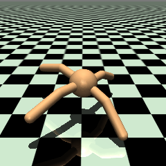 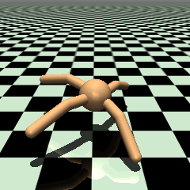

- **엉덩이 관절은 거의 안 움직입니다.** 다리를 앞뒤로 휘두르지 않고, 다리를 뻣뻣하게 편 채 발목 1~2개를 약 0.3초 주기로 떱니다.
  주기성은 약하고(자기상관 0.2~0.35), 다리끼리 규칙적으로 교대하는 접촉 패턴도 없습니다.
- **시간의 약 1/3은 네 발이 모두 공중**입니다. 걷기보다는 통통 튀며 미끄러지는 이동입니다. 몸통·윗다리가 바닥에 끌리지는 않습니다.
- **굳은 상태는 관절 8개가 모두 한계에 붙고 네 발이 바닥에 닿은 정지 자세**입니다.
- **행동 포화 ≠ 관절 각도 포화.** v5의 포화 비율(|행동| > 0.99)은 정책 출력만 봅니다. 작은 토크로도 관절은 한계까지 밀리므로,
  v2~v4의 "몸을 한계에 굳히는" 문제는 v5b에서도 관절 각도 수준에서는 남아 있습니다.
- 정리: v5b는 tanh로 행동 포화를 줄이고 명령 방향 이동을 개선했지만, **규칙적인 다리 교대 보행은 아직 학습하지 못했습니다.**

**2. 기계에 따라 명령별 결과가 다름**

데스크톱에서 평가한 v5b를 노트북에서 다시 평가하면(같은 코드·라이브러리 버전) 평균 속도 0.317 → 0.240 m/s,
명령별로는 걷기와 굳기가 뒤바뀌었습니다(예: 0.5 m/s 90°: 0.56 → 0.00, 1.0 m/s 225°: 0.00 → 0.26).
노트북에서 평가했던 v5 seed 0은 노트북에서 16개 모두 그대로 재현됐습니다.

**3. 초기 상태 민감성 (`python sensitivity.py`, 결과 `runs/sensitivity/sensitivity.json`)**

같은 노트북·정책·명령·평가 seed에서, reset 직후 관절 위치(또는 속도) 8개에 1e-9 × N(0, 1)을 더해 명령마다 10번씩 굴렸습니다
(MuJoCo 상태는 float64, 적용 직후 차이 1.3e-9가 실제로 남는 것을 확인).

| run | 항상 이동 | 항상 정지 | 흔들기에 따라 바뀜 | 평균 이동 확률 |
| --- | --- | --- | --- | --- |
| v5 seed 0 / 1 / 2 | 6 / 2 / 1 | 0 / 5 / 12 | 10 / 9 / 3 | 0.73 / 0.41 / 0.14 |
| v5b seed 0 / 1 / 2 | 7 / 3 / 7 | 2 / 4 / 2 | 7 / 9 / 7 | 0.72 / 0.58 / 0.59 |

- 명령 16개 중 3~10개는 1e-9 차이로 걷기/굳기가 갈립니다. 같은 명령의 속도 폭(최대 − 최소)은 중간값 0.15~0.25 m/s, 최대 0.6 m/s.
- 같은 무작위 행동 열을 넣어도 1e-9 차이가 200스텝 뒤 1 수준으로 커집니다(접촉이 있는 물리 시뮬레이션 자체가 민감).
- 기계 간 차이와 잘 맞는 결과이지만, CPU 차이가 원인이라는 증명은 아닙니다.
- 확률로 보면 v5 → v5b 개선은 유지됩니다(평균 이동 확률 0.43 → 0.63, seed 간 편차도 감소).
  "seed 0이 가장 좋다"는 v5에서만 뚜렷하고, 방향별 실패(예: (−x, −y) 대각선) 결론은 한 번 굴린 결과라 버립니다.
- 임시 기준(마지막 2초 관절 전부 한계 + 거의 정지)으로 보면 v5b 에피소드의 8~19%는 **걷다가 도중에 굳었습니다.**

## 한계와 다음 단계

### 다음 실험 (하나씩 바꿔서 비교)

- ~~**sigma 키우기:** 0.25 → 1.0~~ → v3에서 시도, 단독으로는 효과 없음
- ~~**속도 추종 가중치 키우기:** 2 → 5~~ → v4에서 시도, 노이즈 켬 성능만 개선
- ~~**v4b: 학습률 고정 + 더 학습**~~ → 노이즈 켬 성능 개선, 노이즈 의존은 그대로
- ~~**v5: 행동을 tanh로 묶기**~~ → 노이즈 없이도 걷기 시작, 포화 0
- ~~**v5b: v5 + 학습률 고정 + 더 학습**~~ → 현재 최선 후보 (반복 평가에서도 seed 3개 모두 v5보다 나음)
- ~~**seed 반복 (v5, v5b × seed 1, 2)**~~ → 이어 학습 개선은 재현, seed 0은 좋은 쪽, 실패 방향은 seed마다 다름
- ~~**보행 방식·재현성 점검**~~ → 관절 각도 포화 + 발목 떨기로 튀는 이동, 1e-9 흔들기로 결과가 바뀜 → 반복 평가 필요

- ~~**50초 반복 평가 (1,920 에피소드)**~~ → 굳음은 노이즈 끔에서만, 노이즈 켬은 굳지 않지만 튀는 이동 + 속도 추종 부족

- ~~**관절 한계 원인 분석**~~ → 8개 관절 모두 한계 쪽으로 직접 밀고 있음(2026-11-10 행동↔관절 대응 버그 수정 후) → 관절 위치에 페널티

- ~~**v6 A/B/C: 관절 한계 위치 페널티**~~ → 노이즈 끔 굳음 0(18 run 전부), 관절 움직임 증가. 하지만 튀는 이동 증가,
  다리 교대 없음, 노이즈 켬 속도 약간 하락. 기준은 v6Bb

- ~~**v7 A/B: 몸통 수직 속도 페널티**~~ → 출렁임·공중 비율·몸통 접촉 감소, 하지만 발목을 한계에 고정해서 얻은 결과라
  속도 하락, 다리 교대 없음. 기준은 v6Bb 유지

- ~~**추진·접촉 분석 (측정만)**~~ → 모든 정책이 0.02~0.03초 충돌형 접촉 + 미끄러짐으로 이동, 정상 디딤("제동 → 추진")은 13~20%.
  문제의 중심을 "억제"에서 "디딤 단계 만들기"로 옮김

- ~~**기준선 보상 비교 (측정만)**~~ → 학습된 v6Bb(노이즈 켬 2933)가 토크 0(3353)과 PD 서기(3842)보다 보상이 낮음.
  행동 공간(토크 150 N·m 단위 + 탐색 노이즈)과 보상 모양(느린 명령에서 서 있기 80%)이 용의자

#### ▶ 다음에 할 일 (후보, 아직 정하지 않음)

- **(완료, 합격 없음) v8: 행동 공간 × 추종 커널 2×2:** 토크 / 관절 목표 각도 + PD, 지금 커널 / 두 항 커널을 함께 바꿔 보고, 탐색 노이즈만 줄인 갈래를
  더합니다. 성공은 보상이 아니라 "50초 동안 명령을 따라 디딤을 반복하는가"로 판정하고, 합격선은 학습 전에 고정했습니다
  ([`docs/V8_DESIGN.md`](docs/V8_DESIGN.md)). 참고: Peng & van de Panne 2017, *Learning Locomotion Skills Using DeepRL: Does the Choice of Action Space Matter?*
- **(완료, 합격 없음) v9: 디딤 보상:** 디딤이 늘지 않았습니다. 학습 중 보너스가 거의 0이어서(탐색 문제), 작은 노이즈 갈래는 서 있기에 빠졌습니다([v9 결과](#v9-디딤-보상-50초-반복-평가), [`docs/V9_DESIGN.md`](docs/V9_DESIGN.md)).
  (토크 · 근육 활성 · 목표 각도 비교).

아래는 기준선 비교 이전에 적어 둔 후보입니다. 기준선 비교 결과로 보면 페널티를 더하는 쪽(발목 한계 강화, v_z 약하게)은 같은 식의 우회로를
다시 만날 가능성이 큽니다.

추진·접촉 분석 이후, 지금까지처럼 원하지 않는 동작을 억제하는 대신 **원하는 동작(일정 시간 지속되는 디딤, 디딤 중 지면 밀기,
다리 교대, 착지 시 미끄러짐 감소)을 직접 유도하는 방향**을 검토합니다. 아직 보상은 설계하지 않았고, 아래 후보는 그 이전 기록입니다.

- **발목 한계 페널티를 따로 키우기:** v7은 발목을 한계에 붙여 v_z를 줄였습니다. v_z 페널티와 함께 발목 관절의 한계 페널티만
  강하게 하면 발목 잠그기 우회로를 막을 수 있는지 확인. 단, v6C처럼 너무 강하면 속도가 떨어진 전례가 있음.
- **v_z 페널티를 약하게(w_z 0.3 안팎):** A(1.0)도 속도가 0.21 → 0.17로 떨어져, 더 약한 값에서 출렁임만 줄일 여지가 있는지.
- **교대 보행을 직접 유도:** 지금까지 페널티 3종(관절 한계, v_z)은 모두 교대 보행을 만들지 못했습니다. 발 접촉 패턴에 대한 보상이나
  주기 신호 입력처럼 걸음 구조를 직접 다루는 방법은 아직 시도하지 않았습니다.
- **속도 추종:** v7에서 추종 성공률이 거의 0. 속도 추종 쪽 후보는 아래 "속도 추종 쪽 그 밖의 후보" 그대로.

#### v7 설계: 몸통 수직 속도 페널티

v6로 "굳음"은 풀렸고, 남은 문제는 (A) 속도 추종 부족과 (B) 바닥을 딛지 않고 튀는 이동입니다. v7은 (B)를 겨냥합니다.

- **가설:** 관절 한계에서 벗어난 정책(v6B)에 몸통 수직 속도 페널티를 추가하면, 과도한 상하 운동을 줄이면서
  수평 이동과 다리 움직임을 유지할 수 있다.
- **사전 측정 (v6Bb, 노이즈 켬, 명령 16개 × 50초, seed 3개):**
  - v_z² 평균 0.18~0.24 (수직 속도 약 0.45 m/s로 명령 방향 속도 0.21보다 큼), 네 발 모두 공중 0.57~0.62.
  - v5b → v6Bb에서 공중 비율은 0.42 → 0.60으로 늘었지만 v_z²는 약 10%만 늘었고, v6Bb는 공중일 때와 발이 닿았을 때의
    v_z²가 같습니다(0.20 / 0.20). 큰 점프가 아니라 몸통이 계속 출렁이면서 발을 짧게 떼는 모습이라,
    **v_z 페널티가 공중 비율까지 줄인다는 보장은 없습니다.** 두 지표는 따로 판정합니다.
  - 스텝당 기존 보상: 추종 약 3.1, 생존 1, 제어 −0.57, 관절 한계 −0.43.
- **바꾼 것 (v6B 대비 하나):** 보상에 `− w_z × v_z²` 추가. `v_z = qvel[2]` = 몸통 free joint 선속도의 z 성분으로 **월드 좌표계**
  (몸통을 45°·90° 기울여도 월드 z 변화와 같음을 확인). 제곱이라 위·아래 모두 억제.

| 설정 | w_z | 지금 출렁임(v_z² ≈ 0.2)에서 페널티 | 비교 |
| --- | --- | --- | --- |
| v7A | 1.0 | 약 −0.2 / 스텝 | 추종 보상의 약 6.5% |
| v7B | 3.0 | 약 −0.6 / 스텝 | 추종 보상의 약 19% |

- **나머지는 v6B와 같음:** tanh, sigma 1.0, 추종 가중치 5, 관절 한계 페널티(범위 끝 20%, 가중치 1.5),
  처음부터 500만 스텝 → 학습률 1e-4 고정 160만 스텝, 학습 seed 0, 1, 2. 학습이 진행돼 v_z²가 줄면 페널티도 작아집니다.
- **run 이름:** `main_v7A`, `main_v7A_s1`, `main_v7A_s2`, 이어 학습 `main_v7Ab`, ... (B도 같은 규칙).
- **평가 지표 추가** (모두 3~50초 구간): 몸통 수직 속도² v_z² (월드 `qvel[2]`), 몸통 평균 높이, 몸통 바닥 접촉 비율,
  윗다리 바닥 접촉 비율(연결부 `aux_geom` + 윗다리 `leg_geom`, 발목 `ankle_geom`은 정상적인 발 접촉이라 제외),
  몸통·윗다리 동시 접촉 비율. v5b, v6Bb도 같은 조건으로 다시 평가해 18 run을 비교합니다(`runs/repeated_v7/`).

**사전 성공 기준 (학습 전에 고정, 결과를 본 뒤 바꾸지 않음).** 노이즈 켬, 학습 seed 3개 평균으로 v6Bb와 비교. 각 항목을 따로 판정하고,
충족하지 못한 항목도 그대로 기록합니다. v_z²와 네 발 공중 비율은 별개 지표로 봅니다.

| 지표 | 성공으로 보는 선 |
| --- | --- |
| 몸통 수직 속도² v_z² | v6Bb 대비 20% 이상 감소 |
| 네 발 동시 공중 비율 | 0.10 이상 감소 (v6Bb 0.60 → 0.50 이하) |
| 엉덩이 움직임 범위 p5–p95 | v6Bb의 80% 이상 |
| 몸통 평균 높이 | 0.5 m 이상 (지금 약 0.63 m, 몸통 반지름 0.25 m라 바닥에 끌면 약 0.3 m) |
| 몸통 접촉 / 윗다리 접촉 | 각각 1% 미만 |
| 명령 방향 속도 (3~50초) | v6Bb보다 seed 표준편차 이상 떨어지지 않음 |
| 대각선 쌍 교대 지표 | v6Bb(약 0.02)보다 뚜렷하게 증가 |

| 결과 | 해석 |
| --- | --- |
| v_z²만 줄고 공중 비율 그대로 | 몸통 출렁임과 튀는 걸음은 별개 → 다음은 공중 비율(발 접촉) 직접 페널티 |
| 둘 다 줄고 엉덩이 범위 유지, 대각선 교대 등장 | 성공 |
| 둘 다 줄었지만 몸이 낮아지고 몸통·윗다리 접촉 증가 | 웅크려 끌고 가기 → 페널티 과함 (특히 B) |
| 속도 크게 감소 | 페널티 과함 |

**노트북에서 확인한 것 (학습 전)**
- `--vz-weight 0`(기본값)이면 직전 코드와 보상·관측이 완전히 같음 (v5 설정, v6B 설정 각각 무작위 행동 2000스텝, 차이 0).
- `--vz-weight 3`이면 보상 차이가 정확히 3 × v_z² (오차 1.8e-15).
- 짧은 학습(32768스텝): 텐서보드 `command/vz2` 기록 확인. 학습 초반 무작위 정책은 v_z² ≈ 0.5로 v6Bb보다 크게 출렁임
  (v7B는 초반에 스텝당 약 −1.5). 초반 `ep_len_mean` v6B 140, v7A 133, v7B 148 → 초반 넘어짐 증가 없음.
- 반복 평가 새 지표: v_z²가 v5b 0.21, v6Bb 0.27로 사전 측정과 맞음. `run_v7.sh` 전체 흐름(학습 → 이어 학습 → 반복 평가
  → git add 대상)을 아주 짧은 스텝으로 끝까지 시험.
- **예상 시간 (데스크톱):** 6쌍 × 약 17분 ≈ 1.7시간 + 반복 평가(18 run) 약 5분.

```bash
git pull
tmux new -s v7              # 원격 연결이 끊겨도 계속 돌도록 (나갈 때 Ctrl+b d, 다시 붙을 때 tmux attach -t v7)
bash run_v7.sh              # 학습 12개 → 반복 평가(v5b, v6Bb 포함 18 run) → commit + push 자동
tail -f runs/v7_all.log     # 진행 상황
```

- 옵션은 `run_v6.sh`와 같음: `PY=.venv/bin/python`, `PUSH=0`, `SEEDS="0"`.
- 결과: `runs/repeated_v7/comparison.md`(맨 위 설정별 표), `runs/repeated_v7/survival.png`, 각 run의 `results/summary_repeated.json`.

그 밖의 후보 (v7 설계 당시 기록):
- **A vs B 재확인 (v6):** v6B가 가장 빠르지만 seed 2가 약해 A와의 차이가 seed 운일 수 있습니다.
- `feet_air_time`(발을 충분히 오래 들었다 디디는 것에 보상)은 지금 튀는 이동을 강화할 수 있어 보류.

#### 관절 한계 원인 분석 (`python limit_analysis.py`, 결과 `runs/limit_analysis/summary.json`)

Ant의 행동은 목표 각도가 아니라 **토크**(모터 gear 150, 행동 ±1)입니다. v5b(seed 0/1/2, 명령 16개 × 초기 상태 2개, 50초)에서
관절이 한계 근처(±2°)에 있을 때 정책이 그 한계 쪽으로 토크를 거는 비율을 쟀습니다.

> **2026-11-10 정정.** 처음 분석은 행동 j를 관절 j와 짝지었는데, Ant의 행동 순서는 hip_4, ankle_4, hip_1, ankle_1, … 이라
> 관절 순서(hip_1, ankle_1, …)와 두 칸 어긋나 있었습니다. 그래서 "정책이 직접 미는 관절"과 "반대로 당기는데도 한계에 머무는 관절"이
> 섞여 있다는 처음 결론은 틀렸습니다. `actuator_trnid`로 대응을 바로잡아 다시 잰 값이 아래 표입니다.

| 관절 | 한계 근처 비율 (켬, seed 0/1/2) | 한계 쪽으로 미는 비율, 노이즈 켬 | 한계 쪽으로 미는 비율, 노이즈 끔 |
| --- | --- | --- | --- |
| 엉덩이1 | 0.76 / 0.90 / 0.91 | 0.87 / 0.94 / 0.94 | 0.94 / 0.99 / 1.00 |
| 발목1 | 0.44 / 0.69 / 0.59 | 0.66 / 0.84 / 0.78 | 0.82 / 0.98 / 0.93 |
| 엉덩이2 | 0.77 / 0.75 / 0.75 | 0.88 / 0.86 / 0.86 | 0.94 / 0.99 / 0.98 |
| 발목2 | 0.93 / 0.77 / 0.76 | 0.95 / 0.87 / 0.88 | 1.00 / 0.99 / 0.98 |
| 엉덩이3 | 0.86 / 0.79 / 0.82 | 0.91 / 0.87 / 0.90 | 0.98 / 1.00 / 0.97 |
| 발목3 | 0.49 / 0.76 / 0.60 | 0.72 / 0.88 / 0.81 | 0.93 / 0.98 / 0.98 |
| 엉덩이4 | 0.81 / 0.83 / 0.91 | 0.90 / 0.91 / 0.95 | 0.97 / 0.99 / 0.99 |
| 발목4 | 0.79 / 0.57 / 0.88 | 0.87 / 0.79 / 0.91 | 0.93 / 0.98 / 0.99 |

- **8개 관절 모두 정책이 한계 쪽으로 직접 밀고 있습니다**(노이즈 켬 0.66~0.95, 끔 0.82~1.00). 한계 자세는 동역학상 떨어지는 자세가
  아니라 정책이 고른 자세입니다. 토크 크기(평균 |a| 0.4~0.9, 즉 60~140 N·m)는 한계에 있든 없든 비슷합니다.
- 관절 위치 페널티(v6)를 고른 판단 자체는 그대로 유효합니다. 정책이 미는 방향과 상관없이 같은 신호를 주기 때문입니다.
  다만 "토크 방향으로는 두 유형을 구분할 수 없어서"라는 처음 근거는 버그에서 나온 것이라 지웁니다.
- 정책이 왜 한계로 미는지는 [기준선 보상 비교](#기준선-보상-비교-학습된-정책-vs-아무것도-안-하기--서-있기)의 가설(토크 단위의 탐색 노이즈를 버티는 자세)로 이어집니다.

#### v6 설계: 관절 한계 페널티 범위·강도 비교

(학습 전에 쓴 설계 기록입니다. 결과는 [v6 결과](#v6-abc-관절-한계-페널티-50초-반복-평가).)

- **가설:** 관절이 한계에 머무는 것 자체를 불리하게 만들면, 한계에 고정된 자세에서 벗어나 다리를 실제로 움직이는 보행을 배운다.
- **바꾼 것 (v5 대비):** 보상에 `− w × P_limit` 추가.
  `P_limit = Σ_관절 [max(0, q − q_soft_hi) + max(0, q_soft_lo − q)]` (rad). 관절마다 실제 하한·상한에서 중심과 반범위를 구하고
  `q_soft = 중심 ± soft × 반범위` 바깥(범위 끝 구간)에서만 페널티.

| 설정 | 범위 끝 구간 (`--limit-soft`) | 가중치 w | 페널티 시작 (엉덩이 ±30° / 발목 30~70°) | 관절 하나 붙음 (엉덩이 / 발목) | 8개 모두 붙음 |
| --- | --- | --- | --- | --- | --- |
| A | 10% (0.9) | 3.0 | ±27° / 32~68° | −0.157 / −0.105 | −1.05 |
| B | 20% (0.8) | 1.5 | ±24° / 34~66° | −0.157 / −0.105 | −1.05 |
| C | 20% (0.8) | 3.0 | ±24° / 34~66° | −0.314 / −0.209 | −2.09 |

- **비교 의도:** A vs B = 최대 크기는 같고 페널티 구간만 다름(좁고 가파름 vs 넓고 완만함). B vs C = 같은 구간에서 강도만 2배.
  A는 한계에서 3°만 비켜서도 페널티가 0이 되고 평가 기준(±2°)과 겹치므로, "비켜서기"가 생기는지도 같이 봅니다.
- **크기 비교:** v5b의 실제 자세 기준 기존 보상은 추종 약 3.4 + 생존 1 − 제어 약 0.6. A·B는 그 20~25%,
  C는 약 45%를 잃습니다. C도 평균적으로는 보상이 양수지만, 학습 초반 + 에너지 0(제어 페널티 최대) 같은 극단에서는
  음수가 될 수 있어 "넘어지는 게 이득"(v0)이 생기는지 `ep_len_mean`과 넘어짐 비율로 확인합니다.
- **나머지는 v5/v5b와 같음:** tanh, sigma 1.0, 추종 가중치 5, 500만 스텝 → 학습률 1e-4 고정으로 160만 스텝, 학습 seed 0, 1, 2.
  v5b에서 이어 학습하지 않고 처음부터 학습합니다(한계에 붙는 행동을 이미 배운 정책을 고치는 효과와 섞이지 않게).
- **run 이름:** `main_v6A`(seed 0) / `main_v6A_s1` / `main_v6A_s2`, 이어 학습은 `main_v6Ab`, `main_v6Ab_s1`, ... (B, C도 같은 규칙).
- **노트북에서 확인한 것 (학습 전):**
  - `--limit-weight 0`(기본값)이면 기존 코드와 보상·관측이 완전히 같음(무작위 행동 2000스텝, 차이 0) → 기존 run 재현에 영향 없음.
  - 8개 관절을 모두 위 한계에 두면 `limit_penalty` 0.69 rad (계산값 0.698).
  - A/B/C 각각 32768스텝 짧은 학습: 텐서보드 `command/limit_penalty`(가중치 곱하기 전 P) 기록 확인(A 0.21, B·C 0.38 — A는 구간이 좁아 같은
    자세에서도 P가 작음). 학습 초반 `ep_len_mean`은 A 157, B 140, C 126으로 페널티 없는 설정(120)보다 짧지 않음 → 초반 넘어짐 증가 없음.
  - `run_v6.sh` 전체 흐름(학습 → 이어 학습 → 건너뛰기 → 반복 평가 → git add 대상)을 아주 짧은 스텝으로 끝까지 시험.
- **예상 시간 (데스크톱):** v5가 seed당 약 13분 + 이어 학습 약 4분이었으므로 9쌍 × 약 17분 ≈ 2.5시간 + 반복 평가(24 run) 약 5~10분.

```bash
git pull
tmux new -s v6              # 원격 연결이 끊겨도 계속 돌도록 (나갈 때 Ctrl+b d, 다시 붙을 때 tmux attach -t v6)
bash run_v6.sh              # 학습 18개 → 반복 평가(v5/v5b 포함 24 run) → commit + push 자동
tail -f runs/v6_all.log     # 다른 창에서 진행 상황 확인 (학습별 출력은 runs/<run>.log, git에는 안 올라감)
```

- 순서는 seed 0의 A·B·C → seed 1 → seed 2라서, 중간에 멈춰도 설정끼리 비교할 수 있습니다. 다시 실행하면 끝난 run은 건너뜁니다
  (중간에 끊긴 run은 처음부터 다시).
- `PY=.venv/bin/python bash run_v6.sh`로 파이썬 경로 지정, `PUSH=0`이면 commit/push 생략, `SEEDS="0"`이면 seed 0만.
- `--resume` 때도 보상 설정(`--tracking-*`, `--limit-*`)은 환경을 새로 만들 때 쓰이므로 스크립트가 똑같이 넘깁니다.
- **성공 기준 (v5b 대비, 노이즈 켬 중심):** 관절 한계 비율만이 아니라
  ① 범위 끝 20% 비율 감소 ② 엉덩이 움직임 범위(p5–p95) 증가 (v5b 축소 평가 기준 노이즈 켬 약 11°, 끔 약 1°)
  ③ 네 발 모두 공중 비율 감소 (v5b 42%) ④ 대각선 다리 교대 지표 증가 ⑤ 명령 방향 속도·추종 성공률 유지 이상
  ⑥ 넘어짐·굳음이 늘지 않음. ①만 좋아지고 ②~④가 그대로면 "한계 근처에서만 비켜선" 것으로 보고,
  관절을 거의 안 움직이게 되면(특히 C) 페널티가 너무 강한 것으로 봅니다.
- 결과를 보고 가장 나은 설정으로 다음 실험(다리 움직임 보상, 속도 추종 개선 등)을 진행합니다. `feet_air_time`은 보류.
- 반복 평가 출력 `runs/repeated/comparison.md` 맨 위에 설정별(학습 seed 평균 ± 표준편차) 표, `survival.png`는 설정별 곡선입니다.

#### 반복 평가 조건과 판정 기준

```bash
python evaluate_repeated.py --check   # 실행 전 확인: reset seed 0~9가 서로 다른 초기 상태인지, 1e-9 흔들기가 상태에 남는지
python evaluate_repeated.py           # 6 runs × 16 명령 × 초기 상태 10개 × 노이즈 끔/켬 = 1920 에피소드 × 1000스텝
python evaluate_repeated.py --runs runs/main_v6 runs/main_v5b   # 새 run과 비교할 때
```

- 결과: `runs/<run>/results/summary_repeated.json`(에피소드별 기록 + 명령별·전체 집계),
  `runs/repeated/comparison.md`(비교표), `runs/repeated/survival.png`(영구 굳음까지 생존 곡선).
  기존 `summary.json`(명령당 한 번 평가)은 참고 기록으로 그대로 둡니다.
- 평가 조건: 50초(1000스텝, 학습 에피소드와 같음), reset seed 0~9(서로 다른 초기 관절 상태 확인됨), 노이즈 끔/켬은 같은
  reset seed를 쓰고 켬의 노이즈 난수 seed는 10000 + reset seed. 속도는 3~15초(기존 평가와 비교용)와 3~50초를 따로 기록.
- 판정 기준
  - 이동 성공: 3~50초 명령 방향 속도 > 0.05 m/s, 넘어지지 않음 / 추종 성공: 명령 속도의 50% 이상, 넘어지지 않음
  - 굳음: 관절 8개 모두 한계 2° 이내 + 관절 각속도 평균 < 0.01 rad/s + 몸통 속도 < 0.02 m/s가 0.5초(10스텝) 이상 연속
  - 에피소드 분류: 넘어짐 / 처음부터 굳음(영구 굳음, 굳기 전 시작점 대비 명령 방향 순변위 < 0.1 m) /
    걷다 영구 굳음 / 일시 굳음(굳었다가 다시 움직임) / 끝까지 이동 / 제자리(굳지 않았지만 이동 실패)
  - 생존 곡선: 사건 = 영구 굳음 시작, 50초까지 안 굳었거나 넘어진 에피소드는 우측 검열(Kaplan–Meier)
- 추가 지표: 관절별 한계 근처 비율·움직인 범위, 몸통 높이 표준편차·범위, 발별 공중 비율, 네 발 모두 공중 비율,
  발별 착지 횟수, 행동 포화 비율.
  v6 준비 때 추가: 관절별 범위 끝 20% 비율(v6 페널티 구간과 같음), 관절별 움직임 범위 p5–p95,
  발 접촉 교대 지표(같은 대각선 두 발 접촉의 상관 `diag_in_phase`, 두 대각선 쌍이 번갈아 닿는 정도 `pair_alternation`;
  trot이면 둘 다 양수), 바닥에 닿은 발 개수 분포.

seed 반복 실행 방법 (기록용):

  ```bash
  s=1  # 2도 같은 방식
  python train.py --squash --timesteps 5000000 --n-envs 8 --seed $s --run-name main_v5_s$s \
      --tracking-sigma 1.0 --tracking-weight 5.0
  python evaluate.py --run runs/main_v5_s$s
  python train.py --resume runs/main_v5_s$s --constant-lr 1e-4 --timesteps 1600000 --n-envs 8 --seed $s \
      --run-name main_v5b_s$s --tracking-sigma 1.0 --tracking-weight 5.0
  python evaluate.py --run runs/main_v5b_s$s
  python seed_stats.py   # 평균 ± 표준편차, 방향별 속도
  ```

  `--resume` 때는 정책 구조(tanh)가 저장된 모델에서 그대로 불러와지므로 `--squash`는 필요 없습니다. 보상 설정
  (`--tracking-sigma`, `--tracking-weight`)은 환경을 새로 만들 때 쓰이므로 똑같이 넘겨야 합니다.

속도 추종 쪽 그 밖의 후보:

- **두 항 더하기:** `exp(−오차²/1.0) + exp(−오차²/0.25)`. 멀리선 넓은 항, 가까이선 좁은 항이 기울기를 줍니다.
  두 항 모두 오차가 줄면 커지므로 보상이 단조롭습니다.
- **커리큘럼:** sigma를 처음엔 크게, 평균 오차가 기준(예: 0.3 m/s) 아래로 내려가면 작게.
- **학습률:** 0까지 줄이지 않고 하한을 두거나 고정해서, 국소 최적에서 빠져나올 여지를 남깁니다.
- 기타 후보: 최근 1초 평균 속도로 추종 점수 계산(FreeMusco, Yu et al. 2018), 생존 보상 비중 낮추기.

### 한계

- Ant는 사족 보행이라 사람형 캐릭터보다 균형 문제가 쉽습니다. 다음은 Humanoid로 확장.
- 동작 스타일(자연스러움)을 보상하지 않아서 걸음걸이가 부자연스러울 수 있습니다.
  모션 데이터를 쓰는 방식(DeepMimic, AMP)이나 대칭성 손실(Yu et al. 2018)과 비교해볼 수 있습니다.
- 명령 전환이 부드러운지는 따로 측정하지 않았습니다.

## 참고 문헌

- Kim, Jung, Lee. *PhysicsFC: Learning User-Controlled Skills for a Physics-Based Football Player Controller.* SIGGRAPH 2025. [arXiv](https://arxiv.org/abs/2504.21216)
- Kim, Lee. *FreeMusco: Motion-Free Learning of Latent Control for Morphology-Adaptive Locomotion in Musculoskeletal Characters.* SIGGRAPH Asia 2025. [arXiv](https://arxiv.org/abs/2511.14205)
- Rudin et al. *Learning to Walk in Minutes Using Massively Parallel Deep Reinforcement Learning.* CoRL 2021. [arXiv](https://arxiv.org/abs/2109.11978)
- Schulman et al. *Proximal Policy Optimization Algorithms.* 2017. [arXiv](https://arxiv.org/abs/1707.06347)
- Yu, Turk, Liu. *Learning Symmetric and Low-Energy Locomotion.* SIGGRAPH 2018. [arXiv](https://arxiv.org/abs/1801.08093)
